<h1 align="center">SortingAlgorithms</h1>

<p align="center">
  <b>An executable, animated, benchmarked atlas of <!--N-->56<!--/N--> sorting algorithms, in nine language editions.</b><br>
  Watch every algorithm run, read how it works, see when to use it, and compare its speed from Python to raw machine code.
</p>

<p align="center">
  
  
  
  
  
</p>

<p align="center">
  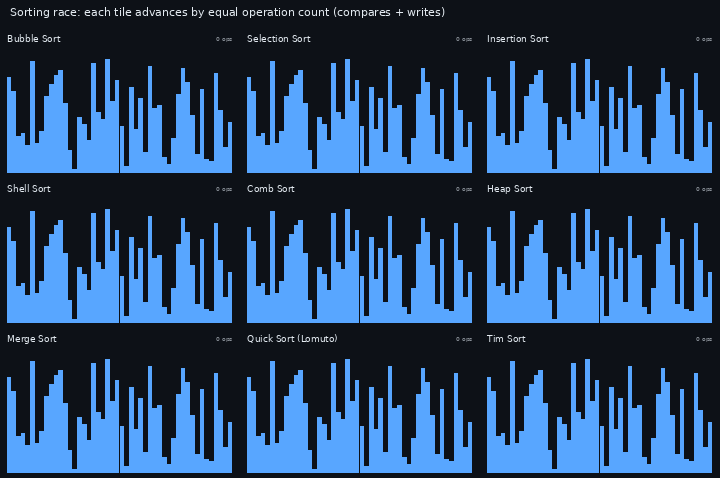
</p>

---

## What is this?

Sorting is the first algorithm most programmers meet and the one that quietly runs under almost every program. This repository
turns it into a hands-on atlas:

- 🎞️ **Every algorithm is animated** from its *real* execution trace, with the active range, pivot, sorted region, an auxiliary-structure
  panel (counts, buckets, piles) and a live compare/write counter. Nothing is faked: the frames come from the same instrumented code that is
  tested and benchmarked.
- 📖 **Every algorithm is explained**: the key idea and invariant, when to use it, when *not* to, its complexity, stability, history and measured cost.
- 🌍 **Every algorithm exists in nine editions**: Python, C, C++, Java, Go, Rust, x86-64 assembly, raw machine code and COBOL, all generated from one
  verified source so they run the *same* algorithm, and all [benchmarked against each other](#language-speed-comparison).
- 🧪 **Everything is tested**: correctness, stability, sorting-network proofs (0-1 principle), memory safety (ASan, Valgrind) and cross-language parity.
- 📊 **A research report** ([REPORT.md](REPORT.md)) measures comparisons, writes and runtime across input shapes, with fitted growth exponents.

## Contents

1. [Quick start](#quick-start)
2. [Sorting in five minutes](#sorting-in-five-minutes) · [How to read the animations](#how-to-read-the-animations) · [Choosing an algorithm](#choosing-an-algorithm)
3. [Catalogue](#catalogue) · [Family races](#family-races) · [Gallery](#gallery)
4. [Benchmarks](#benchmarks-at-a-glance) · [Language speed comparison](#language-speed-comparison)
5. [Nine editions](#nine-editions-of-every-algorithm) · [Architecture](#architecture) · [Testing](#testing) · [Reproducing everything](#reproducing-everything)
6. [Coverage and omissions](#coverage-and-omissions) · [FAQ](#faq) · [Further reading](#further-reading) · [Contributing](#contributing) · [License](#license--citation)

---

## Quick start

**Python** (reference edition, with tracing and statistics):

```sh
pip install -r python/requirements.txt           # only needed for GIFs and charts
export PYTHONPATH=$PWD/python
python -m sorting_algorithms --list              # every algorithm with its complexities
python -m sorting_algorithms --algo quick_sort --size 20 --seed 1 --trace
```

```python
import sorting_algorithms as sa

sa.merge_sort([5, 2, 9, 1])                      # -> [1, 2, 5, 9]   (the input is never mutated)

result, tracer = sa.heap_sort([5, 2, 9, 1], trace=True)
tracer.frames[3]                                 # TraceFrame(state=..., highlights=(0, 3), note='swap', comparisons=..., writes=...)

result, stats = sa.measure("tim_sort", list(range(1000)))
stats.comparisons, stats.writes                  # deterministic and machine-independent
```

**Any other edition** (each has a one-line test and a tiny API; see [Nine editions](#nine-editions-of-every-algorithm)):

```sh
cd c && make test                  # C       void quick_sort(int *arr, size_t n);
cd cpp && make test                # C++     sorting::quick_sort(std::vector<int>&);
cd java && make test               # Java    sorting.QuickSort.sort(int[] a);
cd go && go test ./...             # Go      algorithms.QuickSort(a []int)
cd rust && cargo test              # Rust    quick_sort(a: &mut [i32])
cd assembly && make test           # x86-64  void quick_sort_asm(int *arr, size_t n);
cd machine-code && make test       # raw machine code images, loaded into executable memory
cd cobol && make test              # COBOL   CALL "quick-sort" USING BY REFERENCE tbl BY CONTENT n   (needs GnuCOBOL)
```

---

## Sorting in five minutes

**The problem.** Given a sequence, rearrange it into non-decreasing order. Doing it quickly matters because sorted data unlocks binary search, merging,
de-duplication, grouping and nearest-neighbour queries.

**Two families of algorithms.**

- *Comparison sorts* learn about the data only by asking "is `a < b`?". No comparison sort can beat **⌈log₂ n!⌉ comparisons** in the worst case
  (there are n! orderings and each comparison halves the possibilities at best). That is about *n log₂ n − 1.44 n*:

  | n | 10 | 100 | 1,000 | 1,000,000 |
  | --- | ---: | ---: | ---: | ---: |
  | Minimum comparisons ⌈log₂ n!⌉ | 22 | 525 | 8,530 | ≈ 18,488,885 |

  Merge sort, heap sort and TimSort are within a small factor of this bound; Ford–Johnson comes within a hair of it on small inputs
  (our benchmark: 8,798 comparisons at n = 1024 versus the 8,770 minimum).
- *Non-comparison sorts* exploit the structure of the keys (integers in a range, digits, uniform distribution) and escape the bound: counting sort, radix
  sort and bucket sort run in O(n) when their assumptions hold.

**Properties worth knowing.**

| Term | Meaning | Why it matters |
| --- | --- | --- |
| **Stable** | Equal keys keep their original relative order | Needed to sort by one column and then another (radix sort relies on it) |
| **In-place** | Uses O(1) (or O(log n)) extra memory | Matters on memory-constrained systems and for cache behaviour |
| **Adaptive** | Runs faster on nearly sorted input | Real data is rarely random (logs, appended records) |
| **Online** | Can accept elements one at a time | Streaming data; insertion sort and tree sorts qualify |
| **Data-independent** | Same comparisons regardless of input (sorting networks) | Maps directly to hardware and GPUs |

**Complexity cheat-sheet.** O(n²) algorithms (bubble, selection, insertion) are fine up to a few dozen elements; O(n log n) algorithms (merge, quick, heap,
Tim, intro) scale to millions; O(n + k) algorithms (counting, radix) beat them when the key range *k* is small. See the [measured scaling](REPORT.md).

## How to read the animations

Every animation shows the same elements:

| What you see | Meaning |
| --- | --- |
| **Bars** | One bar per element; the height *and* colour (cyan → indigo) encode the value, so sorted data is a smooth ramp |
| 🟨 **Yellow** | The elements being compared |
| 🟥 **Red** | The elements just written or swapped |
| 🩷 **Pink** | The pivot, the current minimum, or the key being inserted |
| 🟩 **Green** | Elements known to be in their final position (it grows as the algorithm progresses; a final left-to-right sweep verifies the result) |
| **Dimmed bars / lighter background band** | The active sub-range, e.g. the partition quicksort is working on or the runs merge sort is merging |
| **Lower panel** (distribution, patience…) | The auxiliary structure: counters, digit histograms, bucket sizes, pile heights, bead levels |
| **Caption and counters** | The current phase in words, plus running totals of comparisons and writes; the thin bar at the bottom is overall progress |

## Choosing an algorithm

| If you need... | Use | Why |
| --- | --- | --- |
| A safe default for arbitrary data | **TimSort** or **Intro sort** | Guaranteed O(n log n); TimSort is stable and exploits presorted runs |
| Stability *and* a worst-case bound | **Merge sort** / **TimSort** | Stable, O(n log n) |
| Guaranteed O(n log n) with no extra memory | **Heap sort** / **Smooth sort** | In-place; smooth sort is also adaptive (O(n) when sorted) |
| Few elements (≲ 16) | **Insertion sort** | Smallest constant factors; every hybrid uses it as the finisher |
| Data that is *almost* sorted | **Insertion**, **TimSort**, **Smooth**, **Cartesian-tree** | Cost grows with the number of inversions or disorder |
| Many duplicate keys | **3-way quicksort**, **Bingo sort**, **Counting sort** | They finish equal keys together |
| Integers in a small range | **Counting / pigeonhole sort** | O(n + k), no comparisons |
| Fixed-width integers or strings | **Radix sort (LSD / MSD)** | O(d·n) |
| Uniformly distributed reals | **Bucket / Flash sort** | Expected O(n) |
| The fewest possible writes (flash/EEPROM) | **Cycle sort** (or **Selection sort**) | Each element is written at most once |
| The fewest possible comparisons (expensive comparator) | **Ford–Johnson**, **binary insertion**, **merge sort**, **bottom-up heap sort** | Close to ⌈log₂ n!⌉ |
| Parallel hardware / GPU / FPGA | **Bitonic**, **Batcher odd–even merge**, **Pairwise network** | Data-independent comparator schedule |
| Sorted output while data *arrives* | **AVL tree sort**, **Insertion sort**, **Library sort** | Online insertion |
| To teach or to laugh | **Bubble**, **Gnome**, **Stooge**, **Bogo**, **Sleep sort** | Simple, or deliberately terrible |

---

## Catalogue

The table is generated from the code's own metadata, so it cannot drift from the implementations. Click a name to jump to its animation and write-up.

<!-- BEGIN:TABLE -->
| Algorithm | Family | Best | Average | Worst | Extra space | Stable | In-place |
| --- | --- | --- | --- | --- | --- | :-: | :-: |
| [Bubble Sort](#bubble_sort) | Exchange | O(n) | O(n²) | O(n²) | O(1) | ✓ | ✓ |
| [Cocktail Shaker Sort](#cocktail_shaker_sort) | Exchange | O(n) | O(n²) | O(n²) | O(1) | ✓ | ✓ |
| [Odd–Even (Brick) Sort](#odd_even_sort) | Exchange | O(n) | O(n²) | O(n²) | O(1) | ✓ | ✓ |
| [Comb Sort](#comb_sort) | Exchange | O(n log n) | O(n²/2^p) | O(n²) | O(1) | ✗ | ✓ |
| [Gnome Sort](#gnome_sort) | Exchange | O(n) | O(n²) | O(n²) | O(1) | ✓ | ✓ |
| [Exchange Sort](#exchange_sort) | Exchange | O(n²) | O(n²) | O(n²) | O(1) | ✗ | ✓ |
| [Circle Sort](#circle_sort) | Exchange | O(n log n) | O(n log² n) | O(n log² n) | O(log n) | ✗ | ✓ |
| [Quick Sort (Lomuto)](#quick_sort) | Exchange | O(n log n) | O(n log n) | O(n²) | O(log n) | ✗ | ✓ |
| [Quick Sort (Hoare)](#quick_sort_hoare) | Exchange | O(n log n) | O(n log n) | O(n²) | O(log n) | ✗ | ✓ |
| [Quick Sort (3-way)](#quick_sort_3way) | Exchange | O(n) | O(n log n) | O(n²) | O(log n) | ✗ | ✓ |
| [Quick Sort (Dual-Pivot)](#quick_sort_dual_pivot) | Exchange | O(n log n) | O(n log n) | O(n²) | O(log n) | ✗ | ✓ |
| [Stooge Sort](#stooge_sort) | Exchange | O(n^2.71) | O(n^2.71) | O(n^2.71) | O(log n) | ✗ | ✓ |
| [Slow Sort](#slow_sort) | Exchange | Ω(n^(log n / 2+ε)) | super-polynomial | super-polynomial | O(n) | ✗ | ✓ |
| [Pancake Sort](#pancake_sort) | Exchange | O(n) | O(n²) | O(n²) | O(1) | ✗ | ✓ |
| [Permutation Sort](#permutation_sort) | Exchange | O(n) | O(n·n!) | O(n·n!) | O(n) | ✓ | ✗ |
| [Selection Sort](#selection_sort) | Selection | O(n²) | O(n²) | O(n²) | O(1) | ✗ | ✓ |
| [Double Selection Sort](#double_selection_sort) | Selection | O(n²) | O(n²) | O(n²) | O(1) | ✗ | ✓ |
| [Bingo Sort](#bingo_sort) | Selection | O(n + k·n) | O(n·k) | O(n²) | O(1) | ✗ | ✓ |
| [Cycle Sort](#cycle_sort) | Selection | O(n²) | O(n²) | O(n²) | O(1) | ✗ | ✓ |
| [Heap Sort](#heap_sort) | Selection | O(n log n) | O(n log n) | O(n log n) | O(1) | ✗ | ✓ |
| [Smooth Sort](#smooth_sort) | Selection | O(n) | O(n log n) | O(n log n) | O(1) | ✗ | ✓ |
| [Tournament Sort](#tournament_sort) | Selection | O(n log n) | O(n log n) | O(n log n) | O(n) | ✓ | ✗ |
| [Weak Heap Sort](#weak_heap_sort) | Selection | O(n log n) | O(n log n) | O(n log n) | O(n) bits | ✗ | ✓ |
| [Bottom-Up Heap Sort](#bottom_up_heap_sort) | Selection | O(n log n) | O(n log n) | O(n log n) | O(1) | ✗ | ✓ |
| [Ternary Heap Sort](#ternary_heap_sort) | Selection | O(n log n) | O(n log n) | O(n log n) | O(1) | ✗ | ✓ |
| [Enumeration (Rank) Sort](#enumeration_sort) | Selection | O(n²) | O(n²) | O(n²) | O(n) | ✓ | ✗ |
| [Insertion Sort](#insertion_sort) | Insertion | O(n) | O(n²) | O(n²) | O(1) | ✓ | ✓ |
| [Binary Insertion Sort](#binary_insertion_sort) | Insertion | O(n log n) | O(n²) | O(n²) | O(1) | ✓ | ✓ |
| [Shell Sort](#shell_sort) | Insertion | O(n log n) | ~O(n^1.5) | O(n²) | O(1) | ✗ | ✓ |
| [Shell Sort (Ciura gaps)](#shell_sort_ciura) | Insertion | O(n log n) | unknown (≈O(n^1.25)) | O(n²) | O(1) | ✗ | ✓ |
| [Tree Sort (BST)](#tree_sort) | Insertion | O(n log n) | O(n log n) | O(n²) | O(n) | ✓ | ✗ |
| [AVL Tree Sort](#avl_tree_sort) | Insertion | O(n log n) | O(n log n) | O(n log n) | O(n) | ✓ | ✗ |
| [Patience Sort](#patience_sort) | Insertion | O(n log n) | O(n log n) | O(n log n) | O(n) | ✗ | ✗ |
| [Merge-Insertion Sort (Ford–Johnson)](#ford_johnson_sort) | Insertion | O(n log n) | O(n log n) | O(n log n) | O(n) | ✗ | ✗ |
| [Library Sort (Gapped Insertion)](#library_sort) | Insertion | O(n log n) | O(n log n) expected | O(n²) | O(n) | ✓ | ✗ |
| [Cartesian Tree Sort](#cartesian_tree_sort) | Insertion | O(n) | O(n log n) | O(n log n) | O(n) | ✗ | ✗ |
| [Merge Sort](#merge_sort) | Merge | O(n log n) | O(n log n) | O(n log n) | O(n) | ✓ | ✗ |
| [Merge Sort (Bottom-Up)](#merge_sort_bottom_up) | Merge | O(n log n) | O(n log n) | O(n log n) | O(n) | ✓ | ✗ |
| [In-Place Merge Sort](#in_place_merge_sort) | Merge | O(n log n) | O(n log² n) | O(n log² n) | O(log n) | ✓ | ✓ |
| [Strand Sort](#strand_sort) | Merge | O(n) | O(n²) | O(n²) | O(n) | ✓ | ✗ |
| [Tim Sort](#tim_sort) | Hybrid | O(n) | O(n log n) | O(n log n) | O(n) | ✓ | ✗ |
| [Intro Sort](#intro_sort) | Hybrid | O(n log n) | O(n log n) | O(n log n) | O(log n) | ✗ | ✓ |
| [Counting Sort](#counting_sort) | Distribution | O(n + k) | O(n + k) | O(n + k) | O(n + k) | ✓ | ✗ |
| [Pigeonhole Sort](#pigeonhole_sort) | Distribution | O(n + k) | O(n + k) | O(n + k) | O(n + k) | ✓ | ✗ |
| [Radix Sort (LSD)](#radix_sort_lsd) | Distribution | O(d(n + b)) | O(d(n + b)) | O(d(n + b)) | O(n + b) | ✓ | ✗ |
| [Radix Sort (MSD)](#radix_sort_msd) | Distribution | O(n) | O(d·n) | O(d·n) | O(n + b) | ✓ | ✗ |
| [American Flag Sort](#american_flag_sort) | Distribution | O(n) | O(d·n) | O(d·n) | O(b·log n) | ✗ | ✓ |
| [Bucket Sort](#bucket_sort) | Distribution | O(n + k) | O(n + k) | O(n²) | O(n + k) | ✓ | ✗ |
| [Bead (Gravity) Sort](#bead_sort) | Distribution | O(n)–O(S) | O(S) | O(S) | O(n·max) | ✓ | ✗ |
| [Flash Sort](#flash_sort) | Distribution | O(n) | O(n) | O(n²) | O(m) | ✗ | ✓ |
| [Sleep Sort (simulated)](#sleep_sort) | Distribution | O(n + max) | O(n + max) | O(n + max) | O(n) | ✓ | ✗ |
| [Bitonic Sort](#bitonic_sort) | Network | O(n log² n) | O(n log² n) | O(n log² n) | O(1) | ✗ | ✓ |
| [Batcher Odd–Even Merge Sort](#odd_even_merge_sort) | Network | O(n log² n) | O(n log² n) | O(n log² n) | O(1) | ✗ | ✓ |
| [Pairwise Sorting Network](#pairwise_sorting_network) | Network | O(n log² n) | O(n log² n) | O(n log² n) | O(1) | ✗ | ✓ |
| [Bogo Sort](#bogo_sort) | Probabilistic | O(n) | O(n·n!) | unbounded | O(1) | ✗ | ✓ |
| [Bozo Sort](#bozo_sort) | Probabilistic | O(n) | O(n·n!) | unbounded | O(1) | ✗ | ✓ |
<!-- END:TABLE -->

*n* = length, *k* = key range, *d* = digits, *b* = radix, *S* = sum of keys. "Stable" claims are **verified by the test-suite** for every comparison-based algorithm that makes them.

## Family races

Each tile advances by the same number of primitive operations (comparisons + writes), so the order in which they finish is the order of efficiency.

<table>
<tr>
<td>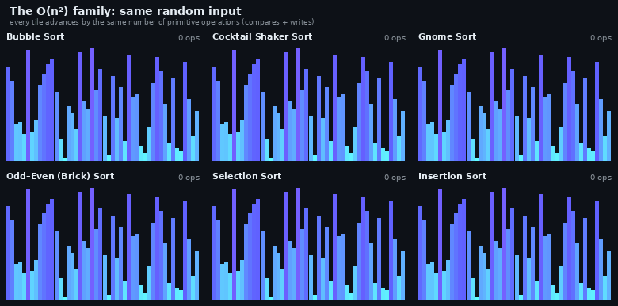</td>
<td>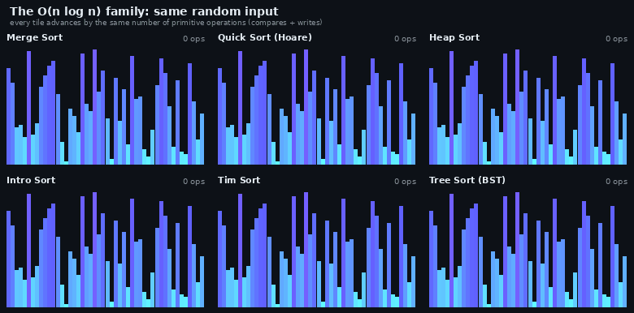</td>
</tr>
<tr>
<td>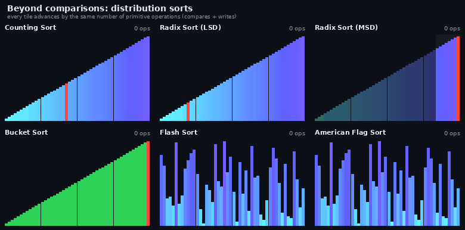</td>
<td>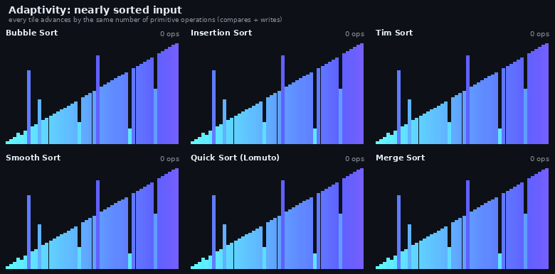</td>
</tr>
<tr>
<td colspan="2" align="center">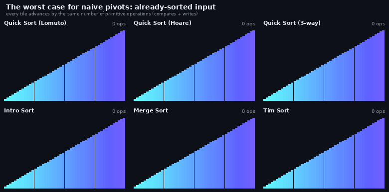<br><sub>Why pivot choice matters: Lomuto quicksort on already-sorted input.</sub></td>
</tr>
</table>

## Gallery

One entry per algorithm: animation, how it works, when to use it, properties, measured cost and origin.

<!-- BEGIN:GALLERY -->
### Exchange

Fix inversions by swapping elements: the bubble family, the quicksorts, and a few pathological relatives.

<a id="bubble_sort"></a>
#### Bubble Sort

<p align="center"></p>

> Repeated adjacent swaps float the maximum to the right; stops early when a pass makes no swap.

**How it works.** Invariant: after pass *i* the *i* largest elements sit in their final places at the right end. Each pass bubbles the current maximum rightward by swapping adjacent inversions; a pass with no swap proves the array is sorted.

**When to use it.** Teaching and tiny inputs only. The early exit makes it linear on already-sorted data, but even insertion sort beats it on nearly everything else because bubble sort performs far more writes.

| Best | Average | Worst | Extra space | Properties |
| :-: | :-: | :-: | :-: | --- |
| O(n) | O(n²) | O(n²) | O(1) | Stable, in-place, adaptive |

<sub>**Measured:** 523,311 comparisons · 522,942 writes at n = 1024 (random input); time at n = 1000: C 0.553 ms · Rust 0.593 ms · Java 0.737 ms · Python 36.1 ms</sub>  
<sub>**Origin:** Teaching staple since the 1950s (Friend 1956; named by Iverson 1962).</sub>

<sub>[↑ back to catalogue](#catalogue)</sub>

<a id="cocktail_shaker_sort"></a>
#### Cocktail Shaker Sort

<p align="center"></p>

> Bidirectional bubble sort: alternating forward and backward passes shrink both ends.

**How it works.** Alternates a left-to-right pass (pushing the maximum to the right) with a right-to-left pass (pulling the minimum to the left), shrinking the unsorted window from both ends.

**When to use it.** Better than bubble sort when small elements start near the end ('turtles'), but still quadratic. A teaching example of a simple optimisation.

| Best | Average | Worst | Extra space | Properties |
| :-: | :-: | :-: | :-: | --- |
| O(n) | O(n²) | O(n²) | O(1) | Stable, in-place, adaptive |

<sub>**Measured:** 400,023 comparisons · 522,942 writes at n = 1024 (random input); time at n = 1000: C 0.612 ms · Rust 0.527 ms · Java 0.541 ms · Python 33.9 ms</sub>  
<sub>**Origin:** Also called bidirectional bubble sort or shuttle sort.</sub>

<sub>[↑ back to catalogue](#catalogue)</sub>

<a id="odd_even_sort"></a>
#### Odd–Even (Brick) Sort

<p align="center"></p>

> Alternates compare-exchange phases over odd and even adjacent pairs; every phase is parallelisable.

**How it works.** Alternately compare-exchanges all (odd, even) neighbour pairs and then all (even, odd) pairs. Inside one phase every pair is independent, so the phase can run in parallel.

**When to use it.** Interesting on parallel hardware (mesh processors, SIMD) where each phase is one step; sequentially it is just a slow bubble-sort variant.

| Best | Average | Worst | Extra space | Properties |
| :-: | :-: | :-: | :-: | --- |
| O(n) | O(n²) | O(n²) | O(1) | Stable, in-place, adaptive |

<sub>**Measured:** 509,454 comparisons · 522,942 writes at n = 1024 (random input); time at n = 1000: C 0.623 ms · Rust 0.493 ms · Java 0.580 ms · Python 42.3 ms</sub>  
<sub>**Origin:** Habermann 1972; the basis of mesh-connected parallel sorting.</sub>

<sub>[↑ back to catalogue](#catalogue)</sub>

<a id="comb_sort"></a>
#### Comb Sort

<p align="center"></p>

> Bubble sort with a shrinking gap (factor 1.3) so small values near the end move quickly.

**How it works.** Bubble sort that compares elements a *gap* apart, shrinking the gap by a factor of about 1.3 each pass. Large gaps move small values near the end ('turtles') quickly, so the final gap-1 passes have little left to do.

**When to use it.** A surprisingly good O(n log n)-ish sort for a dozen lines of code. Not stable and with no worst-case guarantee better than O(n²), so prefer a real library sort in production.

| Best | Average | Worst | Extra space | Properties |
| :-: | :-: | :-: | :-: | --- |
| O(n log n) | O(n²/2^p) | O(n²) | O(1) | Unstable, in-place, adaptive |

<sub>**Measured:** 22,237 comparisons · 9,210 writes at n = 1024 (random input); time at n = 1000: C 0.035 ms · Rust 0.031 ms · Java 0.050 ms · Python 1.543 ms</sub>  
<sub>**Origin:** Włodzimierz Dobosiewicz 1980; popularised by Lacey & Box, BYTE 1991.</sub>

<sub>[↑ back to catalogue](#catalogue)</sub>

<a id="gnome_sort"></a>
#### Gnome Sort

<p align="center"></p>

> A garden gnome steps forward when in order and swaps backward when not.

**How it works.** A single pointer walks right while neighbours are in order; on an inversion it swaps and steps back, exactly like a garden gnome sorting flower pots. It is insertion sort expressed as one loop.

**When to use it.** Teaching and code golf. Quadratic, but the simplest correct sorting loop there is.

| Best | Average | Worst | Extra space | Properties |
| :-: | :-: | :-: | :-: | --- |
| O(n) | O(n²) | O(n²) | O(1) | Stable, in-place, adaptive |

<sub>**Measured:** 523,958 comparisons · 522,942 writes at n = 1024 (random input); time at n = 1000: C 1.426 ms · Rust 0.613 ms · Java 0.684 ms · Python 40.7 ms</sub>  
<sub>**Origin:** Hamid Sarbazi-Azad 2000 ("stupid sort"); renamed by Dick Grune.</sub>

<sub>[↑ back to catalogue](#catalogue)</sub>

<a id="exchange_sort"></a>
#### Exchange Sort

<p align="center"></p>

> Compares position i with every later position and swaps whenever they are inverted.

**How it works.** For each position *i*, compare with every later position and swap whenever the pair is inverted, so position *i* ends up holding the minimum of the suffix.

**When to use it.** A simpler (and slower) cousin of selection sort that swaps far more often. Only useful as a baseline.

| Best | Average | Worst | Extra space | Properties |
| :-: | :-: | :-: | :-: | --- |
| O(n²) | O(n²) | O(n²) | O(1) | Unstable, in-place |

<sub>**Measured:** 523,776 comparisons · 522,942 writes at n = 1024 (random input); time at n = 1000: C 0.808 ms · Rust 0.731 ms · Java 0.759 ms · Python 25.8 ms</sub>  
<sub>**Origin:** Folklore; the simplest quadratic sort to write down.</sub>

<sub>[↑ back to catalogue](#catalogue)</sub>

<a id="circle_sort"></a>
#### Circle Sort

<p align="center"></p>

> Compares first with last, second with second-last, …, recurses on halves, repeats until clean.

**How it works.** Compare the first element with the last, the second with the second-last, and so on, then recurse on both halves; repeat the whole procedure until a pass makes no swap.

**When to use it.** A curiosity with a neat recursive structure and O(n log² n) behaviour; not competitive with merge or quick sort.

| Best | Average | Worst | Extra space | Properties |
| :-: | :-: | :-: | :-: | --- |
| O(n log n) | O(n log² n) | O(n log² n) | O(log n) | Unstable, in-place |

<sub>**Measured:** 51,200 comparisons · 17,398 writes at n = 1024 (random input); time at n = 1000: C 0.116 ms · Rust 0.123 ms · Java 0.187 ms · Python 6.252 ms</sub>  
<sub>**Origin:** Described by Gabriel Dabbs, 2014.</sub>

<sub>[↑ back to catalogue](#catalogue)</sub>

<a id="quick_sort"></a>
#### Quick Sort (Lomuto)

<p align="center">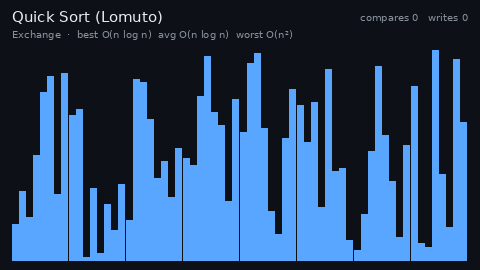</p>

> Partition around the last element with Lomuto's single-index scheme, then recurse.

**How it works.** Pick the last element as pivot; Lomuto's scan keeps `[lo, i)` ≤ pivot and `[i, j)` > pivot, then drops the pivot between them. The pivot is now final; recurse on both sides.

**When to use it.** The default O(n log n) workhorse, but with an end pivot it degrades to O(n²) on sorted input (see the benchmark report). Use a median-of-three/random pivot or intro sort for real data.

| Best | Average | Worst | Extra space | Properties |
| :-: | :-: | :-: | :-: | --- |
| O(n log n) | O(n log n) | O(n²) | O(log n) | Unstable, in-place |

<sub>**Measured:** 11,403 comparisons · 12,506 writes at n = 1024 (random input); time at n = 1000: C 0.019 ms · Rust 0.019 ms · Java 0.046 ms · Python 0.866 ms</sub>  
<sub>**Origin:** Tony Hoare 1959; Lomuto partition popularised by Bentley's Programming Pearls.</sub>

<sub>[↑ back to catalogue](#catalogue)</sub>

<a id="quick_sort_hoare"></a>
#### Quick Sort (Hoare)

<p align="center"></p>

> Two indices converge from both ends around a middle pivot; fewer swaps than Lomuto.

**How it works.** Two indices walk toward each other from both ends around a middle pivot, swapping out-of-place pairs where they stop. Hoare's scheme does about a third of Lomuto's swaps and is not hurt by sorted input (the middle element is a good pivot).

**When to use it.** The better classic quicksort partition. Still O(n²) in contrived worst cases and unstable.

| Best | Average | Worst | Extra space | Properties |
| :-: | :-: | :-: | :-: | --- |
| O(n log n) | O(n log n) | O(n²) | O(log n) | Unstable, in-place |

<sub>**Measured:** 14,558 comparisons · 4,802 writes at n = 1024 (random input); time at n = 1000: C 0.024 ms · Rust 0.020 ms · Java 0.030 ms · Python 0.733 ms</sub>  
<sub>**Origin:** Hoare's original 1961 partition scheme.</sub>

<sub>[↑ back to catalogue](#catalogue)</sub>

<a id="quick_sort_3way"></a>
#### Quick Sort (3-way)

<p align="center"></p>

> Dutch-national-flag partition into <, =, > pivot; linear time on inputs with few distinct keys.

**How it works.** Dutch-national-flag partition into `< pivot`, `= pivot`, `> pivot`. All keys equal to the pivot are finished at once, so inputs with few distinct keys become linear.

**When to use it.** Use when there are many duplicates (log levels, grades, categories). It does slightly more work than 2-way quicksort on distinct keys.

| Best | Average | Worst | Extra space | Properties |
| :-: | :-: | :-: | :-: | --- |
| O(n) | O(n log n) | O(n²) | O(log n) | Unstable, in-place, adaptive |

<sub>**Measured:** 18,020 comparisons · 14,110 writes at n = 1024 (random input); time at n = 1000: C 0.022 ms · Rust 0.027 ms · Java 0.031 ms · Python 1.209 ms</sub>  
<sub>**Origin:** Dijkstra's Dutch national flag problem (1976); Bentley–McIlroy 1993.</sub>

<sub>[↑ back to catalogue](#catalogue)</sub>

<a id="quick_sort_dual_pivot"></a>
#### Quick Sort (Dual-Pivot)

<p align="center"></p>

> Two pivots split the range into three parts; the scheme used by Java's Arrays.sort. This version takes the end elements as pivots, so sorted input is quadratic.

**How it works.** Two pivots p ≤ q split the range into `< p`, `p..q`, `> q`; three recursive calls follow. The scheme behind Java's `Arrays.sort` for primitives, which sample five elements to choose pivots.

**When to use it.** Often faster than single-pivot quicksort thanks to fewer cache misses. This version takes the end elements as pivots, so sorted input is quadratic: pick pivots by sampling in real code.

| Best | Average | Worst | Extra space | Properties |
| :-: | :-: | :-: | :-: | --- |
| O(n log n) | O(n log n) | O(n²) | O(log n) | Unstable, in-place |

<sub>**Measured:** 10,627 comparisons · 7,630 writes at n = 1024 (random input); time at n = 1000: C 0.010 ms · Rust 0.010 ms · Java 0.013 ms · Python 0.603 ms</sub>  
<sub>**Origin:** Vladimir Yaroslavskiy, 2009.</sub>

<sub>[↑ back to catalogue](#catalogue)</sub>

<a id="stooge_sort"></a>
#### Stooge Sort

<p align="center"></p>

> Sort the first 2/3, the last 2/3, then the first 2/3 again. Correct, and deliberately slow.

**How it works.** Sort the first two thirds, then the last two thirds, then the first two thirds again. Correctness: after the first two steps the largest third is at the end; the third step fixes the rest.

**When to use it.** Never use it. It is a classic example of a *correct but absurdly slow* recursion (Θ(n^2.71)) used to teach recurrence analysis.

| Best | Average | Worst | Extra space | Properties |
| :-: | :-: | :-: | :-: | --- |
| O(n^2.71) | O(n^2.71) | O(n^2.71) | O(log n) | Unstable, in-place |

<sub>**Measured:** time at n = 200: C 1.183 ms · Rust 1.603 ms · Java 2.335 ms · Python 64.0 ms</sub>  
<sub>**Origin:** Howard, Fine and Howard — a Three Stooges joke, textbook cautionary example (CLRS problem 7-3).</sub>

<sub>[↑ back to catalogue](#catalogue)</sub>

<a id="slow_sort"></a>
#### Slow Sort

<p align="center"></p>

> 'Multiply and surrender': find the max of each half recursively, then sort the rest the same way.

**How it works.** 'Multiply and surrender': recursively sort both halves, move the maximum to the end, then recurse on everything but the last element. It deliberately wastes work.

**When to use it.** A joke algorithm from the paper on *pessimal* algorithms; its running time is super-polynomial. Included to show how bad correct can be.

| Best | Average | Worst | Extra space | Properties |
| :-: | :-: | :-: | :-: | --- |
| Ω(n^(log n / 2+ε)) | super-polynomial | super-polynomial | O(n) | Unstable, in-place |

<sub>**Measured:** time at n = 16: Java 0.005 ms · Python 0.067 ms</sub>  
<sub>**Origin:** Broder & Stolfi, 'Pessimal Algorithms and Simplexity Analysis', 1986.</sub>

<sub>[↑ back to catalogue](#catalogue)</sub>

<a id="pancake_sort"></a>
#### Pancake Sort

<p align="center"></p>

> Only prefix reversals ('spatula flips') are allowed: bring the max to the front, flip it into place.

**How it works.** The only allowed operation is reversing a prefix (a spatula flip). Bring the largest unsorted pancake to the top with one flip, then flip it down to its place with another.

**When to use it.** A theoretical puzzle (burnt pancake problem, prefix reversals in genomes and interconnection networks). Uses at most 2n − 3 flips.

| Best | Average | Worst | Extra space | Properties |
| :-: | :-: | :-: | :-: | --- |
| O(n) | O(n²) | O(n²) | O(1) | Unstable, in-place, adaptive |

<sub>**Measured:** 523,776 comparisons · 777,354 writes at n = 1024 (random input); time at n = 1000: C 1.123 ms · Rust 0.662 ms · Java 0.721 ms · Python 43.1 ms</sub>  
<sub>**Origin:** Gates & Papadimitriou 1979 (their only joint paper; Gates co-founded Microsoft).</sub>

<sub>[↑ back to catalogue](#catalogue)</sub>

<a id="permutation_sort"></a>
#### Permutation Sort

<p align="center"></p>

> Enumerate permutations in lexicographic order until one is sorted. Deterministic cousin of bogo sort.

**How it works.** Walks through all permutations in lexicographic order and stops at the first sorted one. Because the permutations are of *positions*, equal keys keep their original order, which makes it stable.

**When to use it.** Only for n ≤ 8 or so: O(n·n!). Useful for explaining brute-force search over the permutation space.

| Best | Average | Worst | Extra space | Properties |
| :-: | :-: | :-: | :-: | --- |
| O(n) | O(n·n!) | O(n·n!) | O(n) | Stable, uses extra memory, adaptive |

<sub>**Origin:** Folklore ('exhaustive search sort').</sub>

<sub>[↑ back to catalogue](#catalogue)</sub>

### Selection

Repeatedly select an extreme element: selection sort, the heap family, cycle and tournament sorts.

<a id="selection_sort"></a>
#### Selection Sort

<p align="center"></p>

> Repeatedly select the minimum of the unsorted suffix and swap it into place: exactly n−1 swaps.

**How it works.** Repeatedly select the minimum of the unsorted suffix and swap it to the front. Exactly n − 1 swaps, however the data is arranged.

**When to use it.** The right choice when *writes* are expensive (flash, EEPROM) and n is small, because it performs the fewest swaps of the simple sorts. Quadratic comparisons always.

| Best | Average | Worst | Extra space | Properties |
| :-: | :-: | :-: | :-: | --- |
| O(n²) | O(n²) | O(n²) | O(1) | Unstable, in-place |

<sub>**Measured:** 523,776 comparisons · 2,038 writes at n = 1024 (random input); time at n = 1000: C 0.926 ms · Rust 0.411 ms · Java 0.324 ms · Python 12.2 ms</sub>  
<sub>**Origin:** Folklore; analysed in Knuth TAOCP vol. 3 §5.2.3.</sub>

<sub>[↑ back to catalogue](#catalogue)</sub>

<a id="double_selection_sort"></a>
#### Double Selection Sort

<p align="center">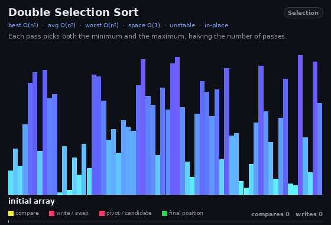</p>

> Each pass picks both the minimum and the maximum, halving the number of passes.

**How it works.** Each pass finds both the minimum and the maximum of the unsorted window and places them at the two ends, halving the number of passes.

**When to use it.** A constant-factor improvement on selection sort; same asymptotics.

| Best | Average | Worst | Extra space | Properties |
| :-: | :-: | :-: | :-: | --- |
| O(n²) | O(n²) | O(n²) | O(1) | Unstable, in-place |

<sub>**Measured:** 521,378 comparisons · 2,038 writes at n = 1024 (random input); time at n = 1000: C 0.165 ms · Rust 0.280 ms · Java 0.222 ms · Python 11.6 ms</sub>  
<sub>**Origin:** Common optimisation of selection sort (also 'bidirectional selection').</sub>

<sub>[↑ back to catalogue](#catalogue)</sub>

<a id="bingo_sort"></a>
#### Bingo Sort

<p align="center"></p>

> Selection sort variant that moves every copy of the current maximum at once; fast with many duplicates.

**How it works.** Like selection sort, but each pass moves *every* copy of the current maximum to the end, then the next-largest value ('bingo!') becomes the target. Few distinct values means few passes.

**When to use it.** A fine fit for inputs with a small number of distinct keys (O(n·k)), but 3-way quicksort or counting sort are usually better.

| Best | Average | Worst | Extra space | Properties |
| :-: | :-: | :-: | :-: | --- |
| O(n + k·n) | O(n·k) | O(n²) | O(1) | Unstable, in-place, adaptive |

<sub>**Measured:** 1,048,574 comparisons · 2,038 writes at n = 1024 (random input); time at n = 1000: C 0.335 ms · Rust 0.498 ms · Java 0.420 ms · Python 19.0 ms</sub>  
<sub>**Origin:** Described in the NIST Dictionary of Algorithms and Data Structures.</sub>

<sub>[↑ back to catalogue](#catalogue)</sub>

<a id="cycle_sort"></a>
#### Cycle Sort

<p align="center"></p>

> Rotates each permutation cycle into place; performs the theoretical minimum number of writes.

**How it works.** Permutation theory: every permutation decomposes into cycles. Count how many elements are smaller than the cycle's first item to find where it belongs, drop it there, pick up the displaced item, and repeat until the cycle closes. Each element is written at most once.

**When to use it.** Optimal when the *number of writes* matters (EEPROM, flash with limited erase cycles). Its O(n²) comparisons make it slow otherwise.

| Best | Average | Worst | Extra space | Properties |
| :-: | :-: | :-: | :-: | --- |
| O(n²) | O(n²) | O(n²) | O(1) | Unstable, in-place |

<sub>**Measured:** 1,564,854 comparisons · 1,024 writes at n = 1024 (random input); time at n = 1000: C 0.811 ms · Rust 0.527 ms · Java 1.113 ms · Python 38.3 ms</sub>  
<sub>**Origin:** B. K. Haddon, 1990.</sub>

<sub>[↑ back to catalogue](#catalogue)</sub>

<a id="heap_sort"></a>
#### Heap Sort

<p align="center"></p>

> Build a max-heap, then repeatedly swap the root to the end and restore the heap.

**How it works.** Build a max-heap in place (a binary tree stored in the array where every parent ≥ its children), then repeatedly swap the root with the last element of the heap and sift it down.

**When to use it.** In-place O(n log n) with a guaranteed worst case and no extra memory, which is why it is the fallback inside intro sort. Poor cache behaviour makes it slower than quicksort in practice and it is unstable.

| Best | Average | Worst | Extra space | Properties |
| :-: | :-: | :-: | :-: | --- |
| O(n log n) | O(n log n) | O(n log n) | O(1) | Unstable, in-place |

<sub>**Measured:** 17,308 comparisons · 18,654 writes at n = 1024 (random input); time at n = 1000: C 0.035 ms · Rust 0.030 ms · Java 0.038 ms · Python 1.308 ms</sub>  
<sub>**Origin:** J. W. J. Williams 1964; Floyd's linear-time heap construction the same year.</sub>

<sub>[↑ back to catalogue](#catalogue)</sub>

<a id="smooth_sort"></a>
#### Smooth Sort

<p align="center"></p>

> Heap sort over a forest of Leonardo heaps; approaches O(n) on nearly sorted input.

**How it works.** Dijkstra's heap sort over a *forest of Leonardo heaps* (trees whose sizes are Leonardo numbers). The forest's shape adapts to presortedness, so sorted input costs only O(n) while the worst case stays O(n log n).

**When to use it.** The in-place sort to pick when data is often nearly sorted *and* a worst-case bound matters. Complex to implement correctly; the bookkeeping is the whole difficulty.

| Best | Average | Worst | Extra space | Properties |
| :-: | :-: | :-: | :-: | --- |
| O(n) | O(n log n) | O(n log n) | O(1) | Unstable, in-place, adaptive |

<sub>**Measured:** 22,696 comparisons · 13,025 writes at n = 1024 (random input); time at n = 1000: C 0.077 ms · Rust 0.082 ms · Java 0.137 ms · Python 2.981 ms</sub>  
<sub>**Origin:** Edsger Dijkstra 1981 (EWD796a); this follows Orson Peters' formulation.</sub>

<sub>[↑ back to catalogue](#catalogue)</sub>

<a id="tournament_sort"></a>
#### Tournament Sort

<p align="center"></p>

> Plays a knockout tournament to find the minimum, then replays only the winner's path per extraction.

**How it works.** Play a knockout tournament over all elements (winner tree). The overall winner is the minimum; remove it and replay only its leaf-to-root path (O(log n)) to find the next.

**When to use it.** The idea behind *replacement selection*, used to build the initial sorted runs for external merge sort.

| Best | Average | Worst | Extra space | Properties |
| :-: | :-: | :-: | :-: | --- |
| O(n log n) | O(n log n) | O(n log n) | O(n) | Stable, uses extra memory |

<sub>**Measured:** 8,938 comparisons · 1,024 writes at n = 1024 (random input); time at n = 1000: C 0.034 ms · Rust 0.040 ms · Java 0.133 ms · Python 1.528 ms</sub>  
<sub>**Origin:** Knuth TAOCP vol. 3 §5.2.3 (replacement selection / tree selection).</sub>

<sub>[↑ back to catalogue](#catalogue)</sub>

<a id="weak_heap_sort"></a>
#### Weak Heap Sort

<p align="center"></p>

> Heap sort on a weak heap (a binary tree with a reverse bit per node); near-optimal comparison count.

**How it works.** A weak heap relaxes the heap condition (only the right subtree must be ≤ the root) and uses one extra bit per node to decide which child is 'right'. Merging two weak heaps takes exactly one comparison.

**When to use it.** Nearly optimal comparison counts for a heap-based in-place sort; a good fit when comparisons are expensive.

| Best | Average | Worst | Extra space | Properties |
| :-: | :-: | :-: | :-: | --- |
| O(n log n) | O(n log n) | O(n log n) | O(n) bits | Unstable, in-place |

<sub>**Measured:** 9,756 comparisons · 12,634 writes at n = 1024 (random input); time at n = 1000: C 0.045 ms · Rust 0.044 ms · Java 0.045 ms · Python 1.512 ms</sub>  
<sub>**Origin:** Dutton 1993; Edelkamp & Wegener 2002.</sub>

<sub>[↑ back to catalogue](#catalogue)</sub>

<a id="bottom_up_heap_sort"></a>
#### Bottom-Up Heap Sort

<p align="center">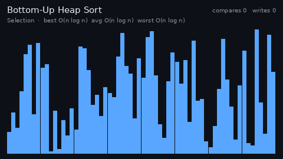</p>

> Heap sort whose sift-down first descends along larger children to a leaf, then climbs back to the key's slot: ~n log n comparisons instead of 2 n log n.

**How it works.** Standard heap sort spends two comparisons per level on sift-down. Wegener's variant first walks down along the larger children to a leaf (one comparison per level), then climbs back up to find the key's slot.

**When to use it.** Saves roughly half the comparisons of ordinary heap sort — a real win when comparing is costly (strings, objects).

| Best | Average | Worst | Extra space | Properties |
| :-: | :-: | :-: | :-: | --- |
| O(n log n) | O(n log n) | O(n log n) | O(1) | Unstable, in-place |

<sub>**Measured:** 10,709 comparisons · 11,781 writes at n = 1024 (random input); time at n = 1000: C 0.061 ms · Rust 0.062 ms · Java 0.069 ms · Python 2.538 ms</sub>  
<sub>**Origin:** Ingo Wegener, 1993 ('Bottom-up heapsort').</sub>

<sub>[↑ back to catalogue](#catalogue)</sub>

<a id="ternary_heap_sort"></a>
#### Ternary Heap Sort

<p align="center">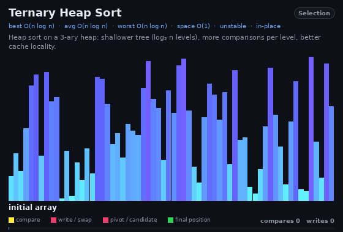</p>

> Heap sort on a 3-ary heap: shallower tree (log₃ n levels), more comparisons per level, better cache locality.

**How it works.** Uses a 3-ary heap: each node has three children, so the tree is log₃ n levels deep. Fewer levels, but more comparisons to pick the best child at each.

**When to use it.** Illustrates the d-ary heap trade-off between depth and fan-out; 3-ary and 4-ary heaps often beat binary ones in practice thanks to cache locality.

| Best | Average | Worst | Extra space | Properties |
| :-: | :-: | :-: | :-: | --- |
| O(n log n) | O(n log n) | O(n log n) | O(1) | Unstable, in-place |

<sub>**Measured:** 16,842 comparisons · 12,914 writes at n = 1024 (random input); time at n = 1000: C 0.025 ms · Rust 0.047 ms · Java 0.045 ms · Python 1.342 ms</sub>  
<sub>**Origin:** d-ary heaps: Johnson 1975; ternary heaps minimise the comparison cost for d = 3.</sub>

<sub>[↑ back to catalogue](#catalogue)</sub>

<a id="enumeration_sort"></a>
#### Enumeration (Rank) Sort

<p align="center">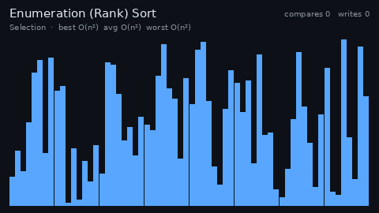</p>

> Compute every element's final rank by counting how many elements precede it, then place it directly.

**How it works.** Compute each element's final *rank* by counting how many elements precede it (ties broken by index), then place it directly at that position.

**When to use it.** The classic parallel sort: every rank can be computed independently, so n² processors sort in O(1) steps. Sequentially it is plain O(n²).

| Best | Average | Worst | Extra space | Properties |
| :-: | :-: | :-: | :-: | --- |
| O(n²) | O(n²) | O(n²) | O(n) | Stable, uses extra memory |

<sub>**Measured:** 1,310,047 comparisons · 1,024 writes at n = 1024 (random input); time at n = 1000: C 1.766 ms · Rust 1.526 ms · Java 1.744 ms · Python 39.2 ms</sub>  
<sub>**Origin:** Folklore; the textbook parallel sort (every rank can be computed independently).</sub>

<sub>[↑ back to catalogue](#catalogue)</sub>

### Insertion

Grow a sorted structure one element at a time: arrays, gapped arrays, trees and piles.

<a id="insertion_sort"></a>
#### Insertion Sort

<p align="center">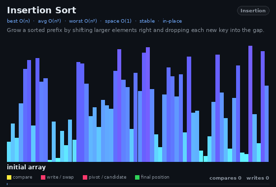</p>

> Grow a sorted prefix by shifting larger elements right and dropping each new key into the gap.

**How it works.** Maintain a sorted prefix. Take the next element, shift larger prefix elements one place right, and drop it into the gap. Its cost is proportional to the number of *inversions* in the input.

**When to use it.** The best simple sort: tiny constant factors, stable, in-place, adaptive. Use it for small arrays (< ~16 elements) and for finishing nearly-sorted data; every serious hybrid sort calls it for small ranges.

| Best | Average | Worst | Extra space | Properties |
| :-: | :-: | :-: | :-: | --- |
| O(n) | O(n²) | O(n²) | O(1) | Stable, in-place, adaptive |

<sub>**Measured:** 262,487 comparisons · 262,490 writes at n = 1024 (random input); time at n = 1000: C 0.124 ms · Rust 0.136 ms · Java 0.188 ms · Python 11.5 ms</sub>  
<sub>**Origin:** Ancient (card-sorting by hand); analysed in Knuth TAOCP vol. 3.</sub>

<sub>[↑ back to catalogue](#catalogue)</sub>

<a id="binary_insertion_sort"></a>
#### Binary Insertion Sort

<p align="center"></p>

> Insertion sort that binary-searches the sorted prefix: O(n log n) comparisons, same O(n²) moves.

**How it works.** Same as insertion sort, but binary-search the sorted prefix for the insertion point. That cuts comparisons to O(n log n), though shifting elements is still O(n²).

**When to use it.** Worth it when comparisons are expensive and moves are cheap. TimSort uses it to extend short runs.

| Best | Average | Worst | Extra space | Properties |
| :-: | :-: | :-: | :-: | --- |
| O(n log n) | O(n²) | O(n²) | O(1) | Stable, in-place |

<sub>**Measured:** 8,839 comparisons · 262,490 writes at n = 1024 (random input); time at n = 1000: C 0.046 ms · Rust 0.134 ms · Java 0.136 ms · Python 10.5 ms</sub>  
<sub>**Origin:** Mauchly 1946 described binary insertion; used inside TimSort for short runs.</sub>

<sub>[↑ back to catalogue](#catalogue)</sub>

<a id="shell_sort"></a>
#### Shell Sort

<p align="center"></p>

> Gapped insertion sorts with gaps n/2, n/4, …, 1 (Shell's original sequence).

**How it works.** Run insertion sort on elements *g* apart for a decreasing sequence of gaps (here n/2, n/4, …, 1). Early large-gap passes move elements long distances cheaply, so the final gap-1 pass finds the array almost sorted.

**When to use it.** A compact in-place sort with O(n^1.5)-ish behaviour; very popular in embedded code because it needs no recursion or extra memory.

| Best | Average | Worst | Extra space | Properties |
| :-: | :-: | :-: | :-: | --- |
| O(n log n) | ~O(n^1.5) | O(n²) | O(1) | Unstable, in-place, adaptive |

<sub>**Measured:** 25,418 comparisons · 20,771 writes at n = 1024 (random input); time at n = 1000: C 0.039 ms · Rust 0.039 ms · Java 0.046 ms · Python 0.931 ms</sub>  
<sub>**Origin:** Donald Shell, 1959 — the first algorithm to break the quadratic barrier.</sub>

<sub>[↑ back to catalogue](#catalogue)</sub>

<a id="shell_sort_ciura"></a>
#### Shell Sort (Ciura gaps)

<p align="center"></p>

> Shell sort with Marcin Ciura's empirically optimal gap sequence 1, 4, 10, 23, 57, 132, 301, 701.

**How it works.** Shell sort with Ciura's empirically derived gap sequence 1, 4, 10, 23, 57, 132, 301, 701 (extended by ×2.25). The gap sequence is the whole game: well-chosen gaps give the best known average-case performance.

**When to use it.** The fastest practical Shell sort; the gap sequence has never been proven optimal.

| Best | Average | Worst | Extra space | Properties |
| :-: | :-: | :-: | :-: | --- |
| O(n log n) | unknown (≈O(n^1.25)) | O(n²) | O(1) | Unstable, in-place, adaptive |

<sub>**Measured:** 13,389 comparisons · 10,494 writes at n = 1024 (random input); time at n = 1000: C 0.034 ms · Rust 0.036 ms · Java 0.040 ms · Python 0.805 ms</sub>  
<sub>**Origin:** Ciura 2001, 'Best Increments for the Average Case of Shell Sort'.</sub>

<sub>[↑ back to catalogue](#catalogue)</sub>

<a id="tree_sort"></a>
#### Tree Sort (BST)

<p align="center">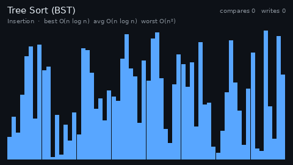</p>

> Insert every key into an unbalanced binary search tree, then read it back in order.

**How it works.** Insert every element into a binary search tree, then read the tree out with an in-order traversal. Equal keys go right, so it is stable.

**When to use it.** Illustrates how a data structure *is* a sorting algorithm. Without balancing it degrades to O(n²) on sorted input (compare AVL tree sort).

| Best | Average | Worst | Extra space | Properties |
| :-: | :-: | :-: | :-: | --- |
| O(n log n) | O(n log n) | O(n²) | O(n) | Stable, uses extra memory |

<sub>**Measured:** 11,600 comparisons · 1,024 writes at n = 1024 (random input); time at n = 1000: C 0.037 ms · Rust 0.037 ms · Java 0.079 ms · Python 0.741 ms</sub>  
<sub>**Origin:** Floyd 1962 and others; degenerates to a linked list on sorted input.</sub>

<sub>[↑ back to catalogue](#catalogue)</sub>

<a id="avl_tree_sort"></a>
#### AVL Tree Sort

<p align="center">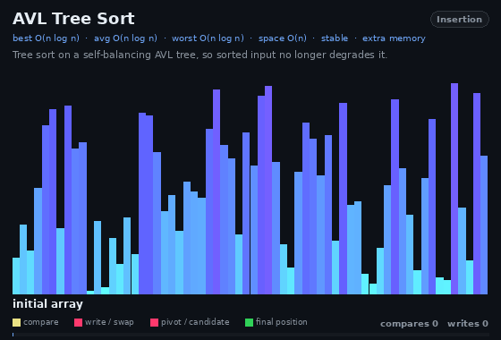</p>

> Tree sort on a self-balancing AVL tree, so sorted input no longer degrades it.

**How it works.** Tree sort on a self-balancing AVL tree: after each insert, rotations keep the subtree heights within 1 of each other, guaranteeing O(log n) inserts.

**When to use it.** A guaranteed O(n log n), stable tree sort. Allocation-heavy, so it loses to array-based sorts, but it also supports *online* insertion.

| Best | Average | Worst | Extra space | Properties |
| :-: | :-: | :-: | :-: | --- |
| O(n log n) | O(n log n) | O(n log n) | O(n) | Stable, uses extra memory |

<sub>**Measured:** 9,010 comparisons · 1,024 writes at n = 1024 (random input); time at n = 1000: C 0.081 ms · Rust 0.124 ms · Java 0.111 ms · Python 4.485 ms</sub>  
<sub>**Origin:** Adelson-Velsky & Landis, 1962.</sub>

<sub>[↑ back to catalogue](#catalogue)</sub>

<a id="patience_sort"></a>
#### Patience Sort

<p align="center"></p>

> Deal cards onto piles (binary-searching the leftmost legal pile), then merge the piles.

**How it works.** Deal elements onto piles as in the card game Patience: put each on the leftmost pile whose top is ≥ it (binary search), or start a new pile. The number of piles equals the length of the longest increasing subsequence; merging the piles yields the sorted order.

**When to use it.** Beyond sorting, it computes the LIS in O(n log n); it is also the basis of the merge phase in external sorting.

| Best | Average | Worst | Extra space | Properties |
| :-: | :-: | :-: | :-: | --- |
| O(n log n) | O(n log n) | O(n log n) | O(n) | Unstable, uses extra memory |

<sub>**Measured:** 13,755 comparisons · 1,024 writes at n = 1024 (random input); time at n = 1000: C 0.096 ms · Rust 0.105 ms · Java 0.135 ms · Python 3.913 ms</sub>  
<sub>**Origin:** Named by Mallows 1960s after the card game; yields the longest increasing subsequence length for free.</sub>

<sub>[↑ back to catalogue](#catalogue)</sub>

<a id="ford_johnson_sort"></a>
#### Merge-Insertion Sort (Ford–Johnson)

<p align="center">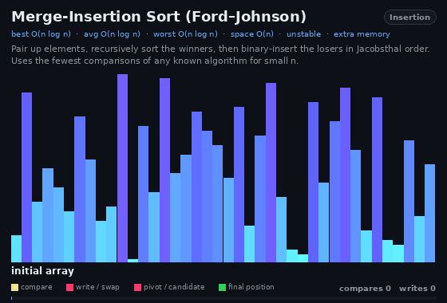</p>

> Pair up elements, recursively sort the winners, then binary-insert the losers in Jacobsthal order. Uses the fewest comparisons of any known algorithm for small n.

**How it works.** Merge-insertion: pair up elements, recursively sort the winners, then binary-insert the losers in an order given by Jacobsthal numbers so that each binary search covers at most 2^k − 1 candidates.

**When to use it.** Uses the fewest comparisons of any known comparison sort for small n (optimal up to n = 22). Wildly impractical otherwise because of the data movement.

| Best | Average | Worst | Extra space | Properties |
| :-: | :-: | :-: | :-: | --- |
| O(n log n) | O(n log n) | O(n log n) | O(n) | Unstable, uses extra memory |

<sub>**Measured:** 8,798 comparisons · 1,024 writes at n = 1024 (random input); time at n = 1000: C 0.153 ms · Rust 0.372 ms · Java 0.720 ms · Python 29.2 ms</sub>  
<sub>**Origin:** Lester Ford Jr. & Selmer Johnson, 1959; optimal for n ≤ 22 (Peczarski 2004).</sub>

<sub>[↑ back to catalogue](#catalogue)</sub>

<a id="library_sort"></a>
#### Library Sort (Gapped Insertion)

<p align="center">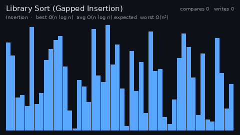</p>

> Insertion sort into an array that keeps gaps, like a librarian leaving shelf space; rebalanced as it doubles.

**How it works.** Insertion sort into an array with *gaps* (like a librarian leaving shelf space). Binary-search for the position, insert into a nearby gap, and re-spread the elements whenever the filled portion doubles.

**When to use it.** Shows how leaving slack turns O(n²) insertion into expected O(n log n). Complicated, so rarely used in practice.

| Best | Average | Worst | Extra space | Properties |
| :-: | :-: | :-: | :-: | --- |
| O(n log n) | O(n log n) expected | O(n²) | O(n) | Stable, uses extra memory |

<sub>**Measured:** 8,938 comparisons · 1,024 writes at n = 1024 (random input); time at n = 1000: C 0.094 ms · Rust 0.089 ms · Java 0.225 ms · Python 2.982 ms</sub>  
<sub>**Origin:** Bender, Farach-Colton & Mosteiro 2004, 'Insertion Sort is O(n log n)'.</sub>

<sub>[↑ back to catalogue](#catalogue)</sub>

<a id="cartesian_tree_sort"></a>
#### Cartesian Tree Sort

<p align="center">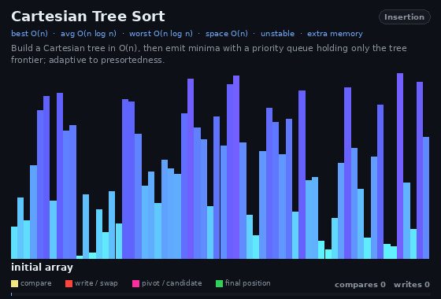</p>

> Build a Cartesian tree in O(n), then emit minima with a priority queue holding only the tree frontier; adaptive to presortedness.

**How it works.** Build a Cartesian tree (a heap-ordered binary tree whose in-order traversal is the input) in O(n) with a stack, then emit elements by popping from a priority queue that holds only the current frontier of the tree.

**When to use it.** An *adaptive* sort: the fewer 'ups and downs' in the input, the smaller the queue stays, down to O(n) for sorted data.

| Best | Average | Worst | Extra space | Properties |
| :-: | :-: | :-: | :-: | --- |
| O(n) | O(n log n) | O(n log n) | O(n) | Unstable, uses extra memory, adaptive |

<sub>**Measured:** 11,739 comparisons · 1,024 writes at n = 1024 (random input); time at n = 1000: C 0.042 ms · Rust 0.021 ms · Java 0.078 ms · Python 1.525 ms</sub>  
<sub>**Origin:** Levcopoulos & Petersson, 1989 ('Heapsort — adapted for presorted files').</sub>

<sub>[↑ back to catalogue](#catalogue)</sub>

### Merge

Combine sorted runs: classic merge sorts, an in-place variant and run-based strand sort.

<a id="merge_sort"></a>
#### Merge Sort

<p align="center"></p>

> Split in half, sort each half recursively, merge the two sorted halves.

**How it works.** Split in half, sort each half recursively, then merge the two sorted halves by repeatedly taking the smaller front element. The merge is linear and stable.

**When to use it.** The reference stable O(n log n) sort with guaranteed worst case; ideal for linked lists and external (disk) sorting. Needs O(n) extra memory for arrays.

| Best | Average | Worst | Extra space | Properties |
| :-: | :-: | :-: | :-: | --- |
| O(n log n) | O(n log n) | O(n log n) | O(n) | Stable, uses extra memory |

<sub>**Measured:** 8,938 comparisons · 9,599 writes at n = 1024 (random input); time at n = 1000: C 0.023 ms · Rust 0.034 ms · Java 0.072 ms · Python 0.926 ms</sub>  
<sub>**Origin:** John von Neumann, 1945 (EDVAC) — one of the first programs ever written for a stored-program computer.</sub>

<sub>[↑ back to catalogue](#catalogue)</sub>

<a id="merge_sort_bottom_up"></a>
#### Merge Sort (Bottom-Up)

<p align="center"></p>

> Iterative merge sort: merge runs of width 1, 2, 4, … with no recursion.

**How it works.** Iterative merge sort: merge adjacent runs of width 1, then 2, 4, 8, … until one run remains. No recursion at all.

**When to use it.** Same guarantees as top-down merge sort with a loop-only structure that suits embedded code and parallel scheduling.

| Best | Average | Worst | Extra space | Properties |
| :-: | :-: | :-: | :-: | --- |
| O(n log n) | O(n log n) | O(n log n) | O(n) | Stable, uses extra memory |

<sub>**Measured:** 8,938 comparisons · 9,599 writes at n = 1024 (random input); time at n = 1000: C 0.022 ms · Rust 0.028 ms · Java 0.087 ms · Python 0.898 ms</sub>  
<sub>**Origin:** Standard in external sorting and in Knuth's Algorithm S.</sub>

<sub>[↑ back to catalogue](#catalogue)</sub>

<a id="in_place_merge_sort"></a>
#### In-Place Merge Sort

<p align="center"></p>

> Merges without a buffer by binary-searching a split point and rotating blocks (SymMerge-style).

**How it works.** Merges without a buffer: pick the middle of the larger run, binary-search its position in the other run, *rotate* the blocks (three reversals) so they swap places, then recurse on both sides.

**When to use it.** Use when stable sorting is required but extra memory is not available; costs an extra log n factor (O(n log² n)). Go's `sort.Stable` uses this idea.

| Best | Average | Worst | Extra space | Properties |
| :-: | :-: | :-: | :-: | --- |
| O(n log n) | O(n log² n) | O(n log² n) | O(log n) | Stable, in-place |

<sub>**Measured:** 9,375 comparisons · 44,502 writes at n = 1024 (random input); time at n = 1000: C 0.081 ms · Rust 0.093 ms · Java 0.103 ms · Python 4.022 ms</sub>  
<sub>**Origin:** Kim & Kutzner 2004 'Stable minimum storage merging by symmetric comparisons'; Go's sort.Stable.</sub>

<sub>[↑ back to catalogue](#catalogue)</sub>

<a id="strand_sort"></a>
#### Strand Sort

<p align="center"></p>

> Repeatedly pull an increasing 'strand' out of the input and merge it into the output list.

**How it works.** Repeatedly pull an ascending *strand* out of the input (the first element plus every later element that extends it) and merge the strand into the output list.

**When to use it.** Adaptive: a nearly sorted input yields a few very long strands. Natural fit for linked lists.

| Best | Average | Worst | Extra space | Properties |
| :-: | :-: | :-: | :-: | --- |
| O(n) | O(n²) | O(n²) | O(n) | Stable, uses extra memory, adaptive |

<sub>**Measured:** 42,690 comparisons · 1,024 writes at n = 1024 (random input); time at n = 1000: C 0.023 ms · Rust 0.044 ms · Java 0.139 ms · Python 3.146 ms</sub>  
<sub>**Origin:** Described in Wikipedia/Knuth exercises; natural-merge flavour.</sub>

<sub>[↑ back to catalogue](#catalogue)</sub>

### Hybrid

Production sorts that stitch several strategies together.

<a id="tim_sort"></a>
#### Tim Sort

<p align="center"></p>

> Detects natural runs, extends short ones with binary insertion, and merges them under stack invariants. (This version omits galloping mode.)

**How it works.** Find *natural runs* (ascending or strictly descending stretches), extend short ones to a minimum length with binary insertion, and merge runs on a stack whose invariants keep merges balanced. (Galloping mode is omitted here.)

**When to use it.** What you almost certainly run: Python's `sorted`, Java's object sort, Android and Rust's stable sort. Linear on presorted data, stable, O(n log n) worst case.

| Best | Average | Worst | Extra space | Properties |
| :-: | :-: | :-: | :-: | --- |
| O(n) | O(n log n) | O(n log n) | O(n) | Stable, uses extra memory, adaptive |

<sub>**Measured:** 8,929 comparisons · 13,983 writes at n = 1024 (random input); time at n = 1000: C 0.017 ms · Rust 0.021 ms · Java 0.050 ms · Python 1.138 ms</sub>  
<sub>**Origin:** Tim Peters 2002 for CPython; default sort in Python, Java (objects), Android, Rust (stable).</sub>

<sub>[↑ back to catalogue](#catalogue)</sub>

<a id="intro_sort"></a>
#### Intro Sort

<p align="center"></p>

> Median-of-three quicksort that switches to heap sort past a depth limit and to insertion sort on tiny ranges.

**How it works.** Quicksort with a median-of-three pivot that counts recursion depth. If the depth exceeds 2·log₂ n it switches to heap sort (guaranteeing O(n log n)), and small ranges are finished with insertion sort.

**When to use it.** The engine of C++'s `std::sort`. Fast on average like quicksort but without its worst case; not stable.

| Best | Average | Worst | Extra space | Properties |
| :-: | :-: | :-: | :-: | --- |
| O(n log n) | O(n log n) | O(n log n) | O(log n) | Unstable, in-place |

<sub>**Measured:** 11,186 comparisons · 6,023 writes at n = 1024 (random input); time at n = 1000: C 0.010 ms · Rust 0.015 ms · Java 0.040 ms · Python 0.529 ms</sub>  
<sub>**Origin:** David Musser, 1997; basis of C++ std::sort in libstdc++ and libc++.</sub>

<sub>[↑ back to catalogue](#catalogue)</sub>

### Distribution

Look at key *values* instead of comparing elements: counting, radix, bucket and friends. Their compare counters stay at 0 because no two elements are ever compared.

<a id="counting_sort"></a>
#### Counting Sort

<p align="center">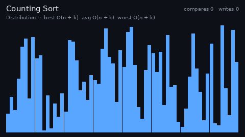</p>

> Count occurrences of each key, prefix-sum the counts into positions, place elements stably.

**How it works.** Count how often each key occurs, turn the counts into starting positions with a prefix sum, then place every element at its key's next free slot. Never compares two elements.

**When to use it.** Unbeatable for integers in a small range (O(n + k)). It is also the stable subroutine inside radix sort. Useless when k ≫ n.

| Best | Average | Worst | Extra space | Properties |
| :-: | :-: | :-: | :-: | --- |
| O(n + k) | O(n + k) | O(n + k) | O(n + k) | Stable, uses extra memory |

<sub>**Measured:** 0 comparisons · 1,024 writes at n = 1024 (random input); time at n = 1000: C 0.007 ms · Rust 0.005 ms · Java 0.061 ms · Python 0.722 ms</sub>  
<sub>**Origin:** Harold Seward, MIT 1954.</sub>

<sub>[↑ back to catalogue](#catalogue)</sub>

<a id="pigeonhole_sort"></a>
#### Pigeonhole Sort

<p align="center"></p>

> Drop each element into the hole for its key, then read the holes back in order.

**How it works.** One 'hole' per possible key value: drop each element into its hole, then read the holes back in order.

**When to use it.** Counting sort's simpler cousin for when keys are dense; as with counting sort, the key range must be small.

| Best | Average | Worst | Extra space | Properties |
| :-: | :-: | :-: | :-: | --- |
| O(n + k) | O(n + k) | O(n + k) | O(n + k) | Stable, uses extra memory |

<sub>**Measured:** 0 comparisons · 1,024 writes at n = 1024 (random input); time at n = 1000: C 0.010 ms · Rust 0.007 ms · Java 0.051 ms · Python 0.373 ms</sub>  
<sub>**Origin:** Folklore variant of counting sort for keys with few gaps.</sub>

<sub>[↑ back to catalogue](#catalogue)</sub>

<a id="radix_sort_lsd"></a>
#### Radix Sort (LSD)

<p align="center">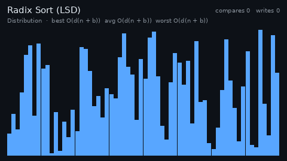</p>

> Stable counting-sort passes on each decimal digit, least significant first; negatives handled by offset.

**How it works.** Sort by the least significant digit first using a *stable* counting sort per digit, then the next digit, and so on. Stability makes later passes preserve earlier work, so after the last pass the keys are sorted.

**When to use it.** Excellent for fixed-width integers and strings: d passes of O(n + b). Needs extra memory and is typically cache-hostile on huge arrays.

| Best | Average | Worst | Extra space | Properties |
| :-: | :-: | :-: | :-: | --- |
| O(d(n + b)) | O(d(n + b)) | O(d(n + b)) | O(n + b) | Stable, uses extra memory |

<sub>**Measured:** 0 comparisons · 1,024 writes at n = 1024 (random input); time at n = 1000: C 0.033 ms · Rust 0.034 ms · Java 0.077 ms · Python 0.773 ms</sub>  
<sub>**Origin:** Herman Hollerith's tabulating machine, 1887; Seward's computer version 1954.</sub>

<sub>[↑ back to catalogue](#catalogue)</sub>

<a id="radix_sort_msd"></a>
#### Radix Sort (MSD)

<p align="center">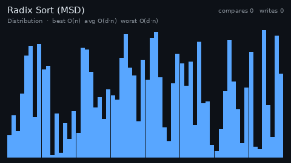</p>

> Bucket by the most significant decimal digit, then recurse into each bucket on the next digit.

**How it works.** Bucket by the most significant digit, then recursively sort each bucket by the next digit. Buckets are independent, so small ones can switch to insertion sort.

**When to use it.** Great for variable-length keys such as strings, where it can stop as soon as buckets are unique (the idea behind burst sort and trie-based sorting).

| Best | Average | Worst | Extra space | Properties |
| :-: | :-: | :-: | :-: | --- |
| O(n) | O(d·n) | O(d·n) | O(n + b) | Stable, uses extra memory |

<sub>**Measured:** 0 comparisons · 1,024 writes at n = 1024 (random input); time at n = 1000: C 0.041 ms · Rust 0.065 ms · Java 0.116 ms · Python 1.553 ms</sub>  
<sub>**Origin:** Classic top-down radix sort; basis of burst/trie sorts for strings.</sub>

<sub>[↑ back to catalogue](#catalogue)</sub>

<a id="american_flag_sort"></a>
#### American Flag Sort

<p align="center"></p>

> In-place MSD radix sort: count digits, then permute elements into their buckets by cycle-leader swaps.

**How it works.** An in-place MSD radix sort: count digit frequencies to learn each bucket's boundaries, then permute elements into place with *cycle-leader* swaps (as in the Dutch national flag problem).

**When to use it.** A memory-lean radix sort (O(1)-ish extra space per level) used for sorting strings in place. Unstable.

| Best | Average | Worst | Extra space | Properties |
| :-: | :-: | :-: | :-: | --- |
| O(n) | O(d·n) | O(d·n) | O(b·log n) | Unstable, in-place |

<sub>**Measured:** 0 comparisons · 5,066 writes at n = 1024 (random input); time at n = 1000: C 0.062 ms · Rust 0.077 ms · Java 0.099 ms · Python 1.536 ms</sub>  
<sub>**Origin:** McIlroy, Bostic & McIlroy 1993, 'Engineering Radix Sort'.</sub>

<sub>[↑ back to catalogue](#catalogue)</sub>

<a id="bucket_sort"></a>
#### Bucket Sort

<p align="center"></p>

> Scatter keys into n equal-width buckets over [min, max], insertion-sort each bucket, concatenate.

**How it works.** Scatter elements into *n* equal-width buckets over [min, max]; with uniformly spread keys each bucket holds about one element. Sort each bucket (insertion sort) and concatenate.

**When to use it.** Linear expected time for uniformly distributed real numbers; degrades to O(n²) if everything lands in one bucket.

| Best | Average | Worst | Extra space | Properties |
| :-: | :-: | :-: | :-: | --- |
| O(n + k) | O(n + k) | O(n²) | O(n + k) | Stable, uses extra memory |

<sub>**Measured:** 0 comparisons · 1,024 writes at n = 1024 (random input); time at n = 1000: C 0.011 ms · Rust 0.011 ms · Java 0.042 ms · Python 0.445 ms</sub>  
<sub>**Origin:** Isaac & Singleton 1956; Knuth TAOCP vol. 3 §5.2.1.</sub>

<sub>[↑ back to catalogue](#catalogue)</sub>

<a id="bead_sort"></a>
#### Bead (Gravity) Sort

<p align="center">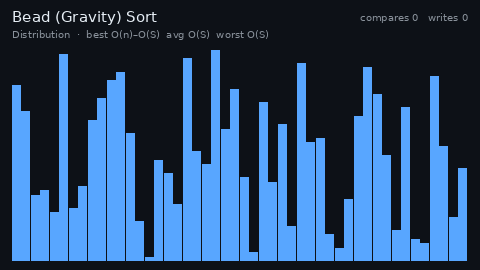</p>

> Beads on rods fall under gravity; each row of beads is a number. S = sum of the inputs.

**How it works.** Each number is a row of beads on vertical rods; let gravity pull the beads down. The rows that appear are the numbers in sorted order. The simulation counts beads per level.

**When to use it.** A beautiful analogue-computing idea that is O(n) on a physical device; in software it costs O(S) (the sum of the inputs), so it is only a demonstration.

| Best | Average | Worst | Extra space | Properties |
| :-: | :-: | :-: | :-: | --- |
| O(n)–O(S) | O(S) | O(S) | O(n·max) | Stable, uses extra memory |

<sub>**Measured:** 0 comparisons · 1,024 writes at n = 1024 (random input); time at n = 1000: C 1.172 ms · Rust 3.232 ms · Java 2.987 ms · Python 238.9 ms</sub>  
<sub>**Origin:** Joshua Arulanandham, Cristian Calude & Michael Dinneen, 2002.</sub>

<sub>[↑ back to catalogue](#catalogue)</sub>

<a id="flash_sort"></a>
#### Flash Sort

<p align="center"></p>

> Classify keys into ~0.43n classes by linear interpolation, permute in place, finish with insertion sort.

**How it works.** Estimate each key's final position by linear interpolation between min and max, count how many keys fall in each of ~0.43n classes, permute elements into their classes in place, then finish with a cheap insertion sort.

**When to use it.** Close to linear on uniformly distributed data with very little extra memory. Sensitive to skewed distributions.

| Best | Average | Worst | Extra space | Properties |
| :-: | :-: | :-: | :-: | --- |
| O(n) | O(n) | O(n²) | O(m) | Unstable, in-place |

<sub>**Measured:** 0 comparisons · 2,706 writes at n = 1024 (random input); time at n = 1000: C 0.015 ms · Rust 0.016 ms · Java 0.026 ms · Python 0.412 ms</sub>  
<sub>**Origin:** Karl-Dietrich Neubert, 1998 (Dr. Dobb's).</sub>

<sub>[↑ back to catalogue](#catalogue)</sub>

<a id="sleep_sort"></a>
#### Sleep Sort (simulated)

<p align="center">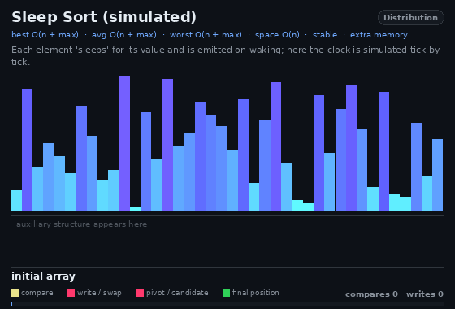</p>

> Each element 'sleeps' for its value and is emitted on waking; here the clock is simulated tick by tick.

**How it works.** Each element 'sleeps' for a time proportional to its value and is output on waking, so smaller values wake first. Here the clock is simulated tick by tick.

**When to use it.** A famous joke: it works only if timing is exact, and it is secretly a counting sort over time. Here to illustrate the idea, not to use.

| Best | Average | Worst | Extra space | Properties |
| :-: | :-: | :-: | :-: | --- |
| O(n + max) | O(n + max) | O(n + max) | O(n) | Stable, uses extra memory |

<sub>**Measured:** 0 comparisons · 1,024 writes at n = 1024 (random input); time at n = 1000: C 0.013 ms · Rust 0.007 ms · Java 0.055 ms · Python 0.428 ms</sub>  
<sub>**Origin:** Anonymous 4chan post, 2011 — a joke that is secretly a counting sort over time.</sub>

<sub>[↑ back to catalogue](#catalogue)</sub>

### Network

Data-independent comparator schedules, ideal for hardware, SIMD and GPUs.

<a id="bitonic_sort"></a>
#### Bitonic Sort

<p align="center"></p>

> Batcher's bitonic network: build ever-longer bitonic sequences, then merge them with half-cleaners.

**How it works.** A sorting *network*: a fixed schedule of compare-exchange operations that does not depend on the data. It builds ever-longer bitonic (up-then-down) sequences, then merges them with half-cleaner stages.

**When to use it.** The sort of choice for GPUs, FPGAs and SIMD, where a data-independent schedule maps directly to parallel hardware. O(log² n) parallel depth.

| Best | Average | Worst | Extra space | Properties |
| :-: | :-: | :-: | :-: | --- |
| O(n log² n) | O(n log² n) | O(n log² n) | O(1) | Unstable, in-place |

<sub>**Measured:** 28,160 comparisons · 28,186 writes at n = 1024 (random input); time at n = 1000: C 0.187 ms · Rust 0.082 ms · Java 0.204 ms · Python 4.659 ms</sub>  
<sub>**Origin:** Ken Batcher, 1968; the workhorse of GPU sorting. Arbitrary n handled by skipping out-of-range comparators.</sub>

<sub>[↑ back to catalogue](#catalogue)</sub>

<a id="odd_even_merge_sort"></a>
#### Batcher Odd–Even Merge Sort

<p align="center"></p>

> Batcher's other network: recursively merge sorted halves with an odd–even merge.

**How it works.** Batcher's other classic network: recursively merge sorted halves with an *odd–even merge* (merge the odd-indexed and even-indexed elements separately, then fix up neighbours with one comparator layer).

**When to use it.** Fewer comparators than bitonic sort for the same size; used in hardware sorters and as the basis of many parallel sorts.

| Best | Average | Worst | Extra space | Properties |
| :-: | :-: | :-: | :-: | --- |
| O(n log² n) | O(n log² n) | O(n log² n) | O(1) | Unstable, in-place |

<sub>**Measured:** 24,063 comparisons · 27,338 writes at n = 1024 (random input); time at n = 1000: C 0.184 ms · Rust 0.186 ms · Java 0.190 ms · Python 5.691 ms</sub>  
<sub>**Origin:** Ken Batcher, 1968; Knuth TAOCP vol. 3 §5.3.4.</sub>

<sub>[↑ back to catalogue](#catalogue)</sub>

<a id="pairwise_sorting_network"></a>
#### Pairwise Sorting Network

<p align="center">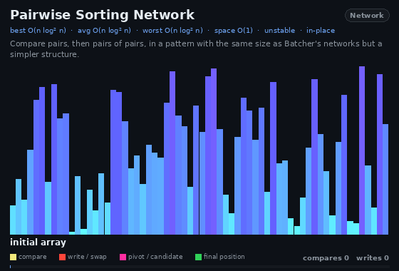</p>

> Compare pairs, then pairs of pairs, in a pattern with the same size as Batcher's networks but a simpler structure.

**How it works.** Parberry's pairwise network first compares elements 1, 2, 4, … apart to build sorted pairs of pairs, then merges them with a second, regular pattern of comparators.

**When to use it.** Same O(n log² n) size as Batcher's networks but with a simpler, more regular structure that is easy to lay out in hardware.

| Best | Average | Worst | Extra space | Properties |
| :-: | :-: | :-: | :-: | --- |
| O(n log² n) | O(n log² n) | O(n log² n) | O(1) | Unstable, in-place |

<sub>**Measured:** 24,063 comparisons · 25,678 writes at n = 1024 (random input); time at n = 1000: C 0.068 ms · Rust 0.068 ms · Java 0.085 ms · Python 3.338 ms</sub>  
<sub>**Origin:** Ian Parberry, 1992 ('The pairwise sorting network').</sub>

<sub>[↑ back to catalogue](#catalogue)</sub>

### Probabilistic

Randomised sorts with no worst-case bound, included as cautionary tales.

<a id="bogo_sort"></a>
#### Bogo Sort

<p align="center"></p>

> Shuffle until sorted. Guarded by max_shuffles so it always terminates.

**How it works.** Shuffle the array; if it is sorted, stop; otherwise shuffle again. Expected n! attempts.

**When to use it.** Pure comedy and a vivid illustration of probabilistic algorithms. Capped by `max_shuffles` here so it always terminates.

| Best | Average | Worst | Extra space | Properties |
| :-: | :-: | :-: | :-: | --- |
| O(n) | O(n·n!) | unbounded | O(1) | Unstable, in-place, adaptive |

<sub>**Origin:** Jargon-file folklore ('permutation sort', 'stupid sort').</sub>

<sub>[↑ back to catalogue](#catalogue)</sub>

<a id="bozo_sort"></a>
#### Bozo Sort

<p align="center">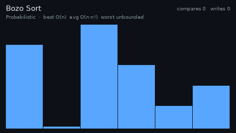</p>

> Swap two random elements, check, repeat. Even less strategic than bogo sort.

**How it works.** Pick two random positions, swap them, check whether the array is sorted, repeat. Even less strategic than bogo sort.

**When to use it.** As above: a humorous baseline. Expected running time is still factorial.

| Best | Average | Worst | Extra space | Properties |
| :-: | :-: | :-: | :-: | --- |
| O(n) | O(n·n!) | unbounded | O(1) | Unstable, in-place, adaptive |

<sub>**Origin:** Jargon-file folklore.</sub>

<sub>[↑ back to catalogue](#catalogue)</sub>

<!-- END:GALLERY -->

---

## Benchmarks at a glance

### Operation counts

Operations per element relative to n·log₂n at n = 1024, for every algorithm and five input shapes (lower is better). Counts are *exact and machine-independent*
because the reference edition instruments every comparison and write.

<p align="center">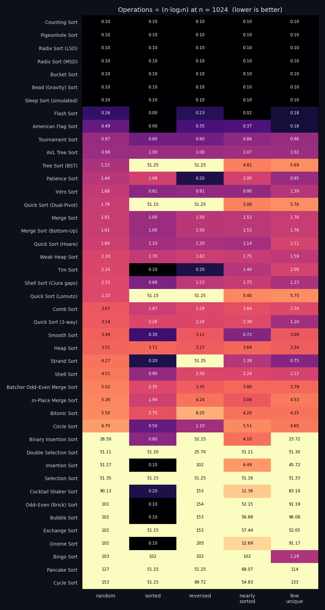</p>

Take-aways, all measured (details in [REPORT.md](REPORT.md)):

- Ford–Johnson, binary insertion and the merge family land within a few percent of the information-theoretic comparison minimum.
- Lomuto and dual-pivot quicksort with end pivots degrade ~20–40× on already sorted input; 3-way quicksort and bingo sort collapse on few-unique-key inputs.
- Adaptive sorts (insertion, TimSort, smooth, Cartesian-tree) approach linear time on nearly sorted data.
- Distribution sorts do zero comparisons, but their cost moves to counters, buckets and digit passes.

<p align="center">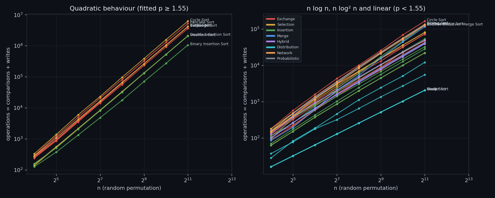</p>

### Language speed comparison

The *same* algorithms, on the *same* deterministic data (n = 1000 values in 0…9999; smaller n for the super-polynomial sorts), timed in all nine editions on one
machine (AMD Ryzen 7 5700U). Each figure is the **median time of one `sort()` call**; Java is JIT-warmed first, COBOL is timed per process with the data-fill baseline
subtracted, and Python is shown twice: the plain *kernels* (what the other editions are generated from) and the *instrumented reference* that counts every comparison and write.
Reproduce with [`benchmarks/compare_languages.py`](benchmarks/compare_languages.py).

<p align="center">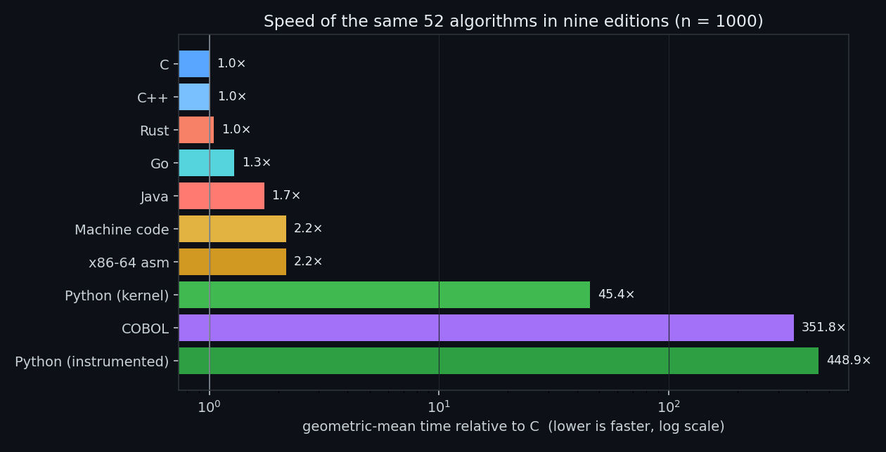</p>

<!-- BEGIN:LANGSUM -->
| Edition | Geometric mean vs C | Median vs C | Fastest on (of 52) | Toolchain |
|---|:-:|:-:|:-:|---|
| C | 1.00× | 1.00× | 15 | gcc (Debian 16.2.0-4) 16.2.0 -O2 |
| C++ | 1.00× | 1.00× | 17 | g++ (Debian 16.2.0-4) 16.2.0 -O2 |
| Rust | 1.05× | 1.02× | 12 | rustc 1.98.1 (48a229cea 2026-09-01) --release |
| Go | 1.29× | 1.26× | 5 | go version go1.26.5 linux/amd64 |
| Java | 1.73× | 1.47× | 0 | openjdk version "25.0.5" 2026-10-20 (JIT, 20 warm-up runs) |
| Machine code | 2.17× | 2.15× | 2 | raw x86-64 images loaded into executable memory |
| x86-64 asm | 2.17× | 2.16× | 2 | GNU as (hand-written 28 + compiled 28), timed through a C harness |
| Python (kernel) | 45.40× | 41.33× | 0 | CPython 3.14.10, plain kernels |
| COBOL | 351.82× | 307.98× | 0 | cobc (GnuCOBOL) 3.2.0 -O2 (process-timed) |
| Python (instrumented) | 448.94× | 296.20× | 0 | CPython 3.14.10, tracing reference implementation (counts every compare/write) |
| ↳ asm, hand-written (27 algorithms) | 1.25× | | | hand-written |
| ↳ asm, compiler-generated | 3.93× | | | `kernels/backends/x86.py` |
<!-- END:LANGSUM -->

Median milliseconds per sort for a dozen representative algorithms:

<!-- BEGIN:LANGSELECT -->
| Algorithm | C | C++ | Rust | Go | Java | Machine code | x86-64 asm | Python (kernel) | COBOL | Python (instrumented) |
|---|---:|---:|---:|---:|---:|---:|---:|---:|---:|---:|
| Bubble Sort | 0.553 | 0.557 | 0.593 | 0.584 | 0.737 | 0.985 | 1.041 | 36.1 | 140.9 | 209.2 |
| Insertion Sort | 0.124 | 0.103 | 0.136 | 0.184 | 0.188 | 0.184 | 0.185 | 11.5 | 68.1 | 139.3 |
| Selection Sort | 0.926 | 0.926 | 0.411 | 0.404 | 0.324 | 0.285 | 0.287 | 12.2 | 58.9 | 175.5 |
| Shell Sort | 0.039 | 0.042 | 0.039 | 0.043 | 0.046 | 0.042 | 0.042 | 0.931 | 4.538 | 8.133 |
| Heap Sort | 0.035 | 0.028 | 0.030 | 0.040 | 0.038 | 0.030 | 0.028 | 1.308 | 6.045 | 8.380 |
| Merge Sort | 0.023 | 0.018 | 0.034 | 0.033 | 0.072 | 0.027 | 0.029 | 0.926 | 6.876 | 6.038 |
| Quick Sort (Lomuto) | 0.019 | 0.016 | 0.019 | 0.017 | 0.046 | 0.021 | 0.022 | 0.866 | 3.021 | 4.974 |
| Intro Sort | 0.010 | 0.011 | 0.015 | 0.017 | 0.040 | 0.016 | 0.016 | 0.529 | 2.898 | 4.146 |
| Tim Sort | 0.017 | 0.017 | 0.021 | 0.025 | 0.050 | 0.027 | 0.028 | 1.138 | 7.360 | 8.540 |
| Radix Sort (LSD) | 0.033 | 0.034 | 0.034 | 0.036 | 0.077 | 0.068 | 0.068 | 0.773 | 26.3 | 187.6 |
| Counting Sort | 0.007 | 0.009 | 0.005 | 0.030 | 0.061 | 0.028 | 0.030 | 0.722 | 4.794 | 46.7 |
| Bitonic Sort | 0.187 | 0.188 | 0.082 | 0.188 | 0.204 | 0.109 | 0.085 | 4.659 | 101.8 | 14.3 |

<!-- END:LANGSELECT -->

<p align="center">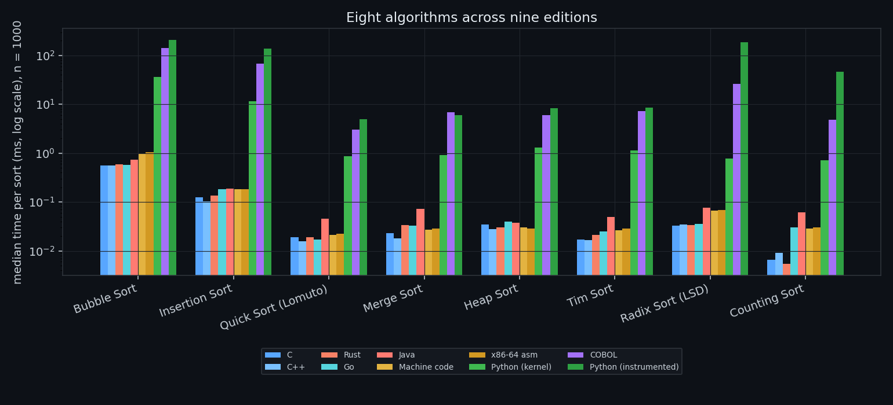</p>

**What the numbers say.**

- **C, C++ and Rust are a statistical tie** (Rust ≈ 1.05× C, with bounds checking on every access). Same algorithm, same LLVM/GCC-class optimiser, same speed.
- **Go ≈ 1.3×** and **Java ≈ 1.7×** (after JIT warm-up) pay for bounds checks, a managed runtime and less aggressive optimisation of tight loops.
- **Hand-written assembly runs at ≈ 1.25× C**, so a careful human with no optimiser is competitive with `gcc -O2` on simple loops, but not better. The
  **compiler-generated assembly** (every variable in a stack slot, no register allocation) is ≈ 3.9× C: a vivid demonstration of what an optimiser buys. **Machine code
  matches assembly exactly**, as it must: it *is* the same bytes.
- **Python (kernels) ≈ 45× C**: pure interpretation of the same loops. The **instrumented reference is ≈ 450×** because it counts and records every operation; that is the price
  of exact statistics and animations.
- **COBOL (GnuCOBOL) ≈ 350× C**: the compiler targets C but performs arithmetic with arbitrary-precision decimals, and every array access is bounds- and
  type-checked at run time.
- The *algorithm* still matters as much as the language: in C, insertion sort (0.12 ms) is 4.5× faster than bubble sort (0.55 ms), and Python's linear-time counting sort (0.72 ms) is on par with C's bubble sort.

*Caveats:* one machine, one input size, one compiler version each; Java numbers exclude JVM start-up; COBOL timings have about 1 ms resolution, so sub-millisecond results
are omitted. See [REPORT.md](REPORT.md) for the full per-algorithm table.

<p align="center">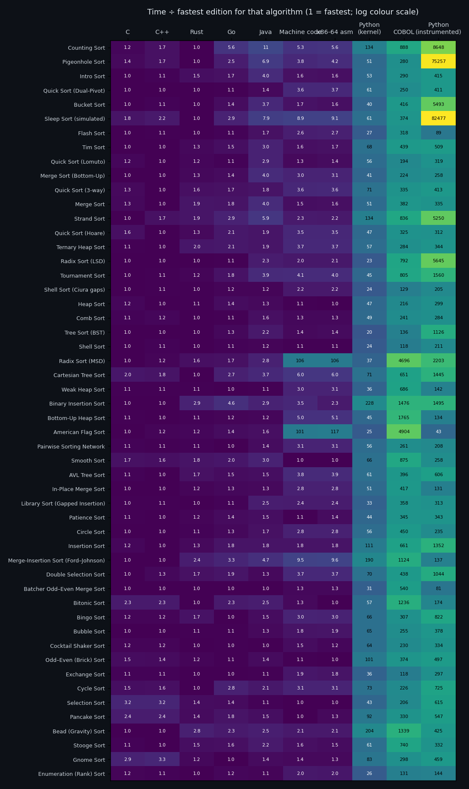</p>

---

## Nine editions of every algorithm

All <!--N-->56<!--/N--> algorithms exist in every language below. Each non-Python edition is generated from one verified source of truth, the
**kernels** in [`kernels/`](kernels/README.md) (a restricted executable Python subset), so they all run the same algorithm.

| Language | Location | How to test | Status |
| --- | --- | --- | --- |
| Python | `python/` | `cd python && python -m pytest` | **Reference** edition: tracing, animation, stability checks, statistics. |
| C | `c/` | `cd c && make test` | → `libsort.a`; warning-free, ASan-clean. |
| C++ | `cpp/` | `cd cpp && make test` | Header-only C++17 (`sorting/all.hpp`). |
| Java | `java/` | `cd java && make test` | One class per algorithm, JDK 17+. |
| Go | `go/` | `cd go && go test ./...` | Package `algorithms`. |
| Rust | `rust/` | `cd rust && cargo test` | Bounds-checked, no `unsafe`. |
| x86-64 assembly | `assembly/` | `cd assembly && make test freestanding` | **28 hand-written** + 28 compiled from kernels; no libc. |
| Machine code | `machine-code/` | `cd machine-code && make test` | **56 raw x86-64 images** (about 37 KB), loaded into executable memory and run. |
| COBOL | `cobol/` | `cd cobol && make test` | 56 GnuCOBOL programs, verified with GnuCOBOL 3.2.0. |

- **Assembly** is GNU `as` Intel syntax with no C and no libc: only two raw `mmap`/`munmap` system calls. The 28 original algorithms are hand-written; the other 28 are output of the
  kernel compiler (`kernels/backends/x86.py`) and are labelled as such. All 56 pass the harness, are Valgrind-clean, and link and run in a `-nostdlib -static` binary.
- **Machine code** is the assembled bytes of those 56 routines, one self-contained, position-independent file each; see [machine-code/README.md](machine-code/README.md).
- Every edition is tested against the language's own sort on random, sorted, reversed, all-equal and `INT_MIN`/`INT_MAX` inputs of many lengths. The super-polynomial algorithms
  (stooge, slow, bogo, bozo, permutation) are tested on small sizes only.

## Architecture

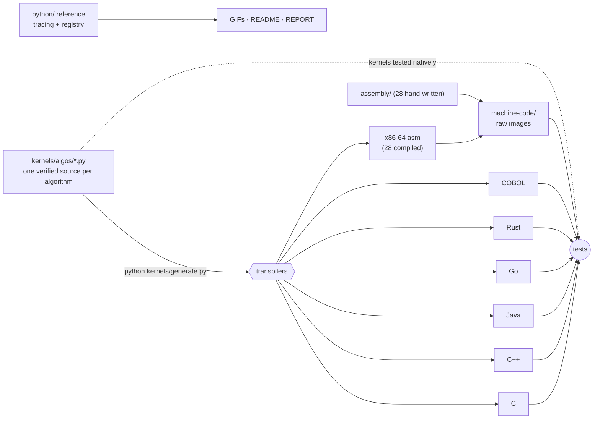

- **Reference edition (`python/`).** Algorithms are plain, readable code against a `Tracked` array that counts comparisons, reads and writes and, when a tracer is attached, emits an animation
  frame for every compare, swap and write, plus presentation hints (active range, sorted region, pivot, caption, auxiliary structure). Each is registered with `@algorithm(...)`, attaching its
  metadata; the catalogue, tests, charts and gallery all read that registry.
- **Kernels (`kernels/`).** A restricted, executable Python subset (integer arrays, loops, recursion). Each kernel is verified natively, then transpiled to C, C++, Java, Go, Rust, COBOL and
  x86-64, so a fix lands in every language at once. CI regenerates everything and fails on drift. See [kernels/README.md](kernels/README.md).
- **Visualisation (`visualizations/`).** A Pillow renderer turns traces into GIFs; no screen capture, no hand animation.
- **Benchmarks (`benchmarks/`).** Operation-count benchmarks (exact), the cross-language runner, and the report generators.

```
python/sorting_algorithms/   reference: base.py (tracking array + registry), algos/<family>.py, notes.py (teaching notes)
python/tests/                correctness, stability, networks, docs consistency
kernels/                     algos/<name>.py single source of truth; generate.py + backends/ (C, C++, Java, Go, Rust, COBOL, x86-64)
c/ cpp/ java/ go/ rust/      generated editions + tests + speed drivers
assembly/  machine-code/     28 hand-written + 28 compiled asm sorts, and the raw x86-64 images built from them
cobol/                       generated GnuCOBOL programs
visualizations/              GIF renderer and generated gifs/ (56 algorithms + 6 races)
benchmarks/  report/         measurement scripts, raw data, figures
scripts/                     build_docs.py regenerates the data-driven README sections
```

## Testing

```sh
cd python    && python -m pytest        # reference: correctness, stability, networks, docs consistency
python kernels/test_kernels.py          # every kernel, natively
python kernels/generate.py --check      # generated files are up to date
cd c         && make test               # C           (also: cpp, java, go, rust, assembly, machine-code, cobol)
cd cpp       && make test
cd java      && make test
cd go        && go test ./...
cd rust      && cargo test
cd assembly  && make test freestanding  # add `make memcheck` for Valgrind
cd machine-code && make test
cd cobol     && make test               # needs GnuCOBOL
```

What is checked: sorted output on random, sorted, reversed, all-equal and extreme-value inputs for many lengths; **stability** for every comparison sort that claims it; the **0-1 principle** (all binary
inputs) for the sorting networks; memory safety (AddressSanitizer for C, Valgrind for assembly, Rust's bounds checks, COBOL `-debug` runs); and that every algorithm has an animation, notes and an entry
in every language. CI runs all of it (`.github/workflows/ci.yml`).

## Reproducing everything

```sh
export PYTHONPATH=$PWD/python
python visualizations/generate_gifs.py           # 56 GIFs + 6 race montages (about two minutes)
python benchmarks/run_benchmarks.py              # operation counts -> report/data/benchmarks.json
python benchmarks/generate_report.py             # figures + REPORT.md
python kernels/generate.py                       # regenerate every non-Python edition
python benchmarks/compare_languages.py           # cross-language timings (set COBC=/path/to/cobc for COBOL)
python benchmarks/language_charts.py             # language charts and tables
python scripts/build_docs.py                     # refresh the data-driven sections of this README
```

---

## Coverage and omissions

The catalogue covers every major family: exchange, selection/heap, insertion/tree, merge, hybrid, distribution, sorting networks and the pathological/probabilistic sorts.
"Every sorting algorithm" is not a finite list, so here is what is deliberately **not** included and why:

| Not implemented | Reason |
| --- | --- |
| Block / WikiSort, GrailSort, pdqsort, ips⁴o, Spreadsort, Burstsort, Cubesort | Highly engineered production algorithms (thousands of lines, many tuning constants) that do not animate or explain cleanly. Their ideas appear through TimSort, intro sort, MSD radix and American flag sort. |
| Shear sort, Rotatesort, other 2-D mesh sorts | Need a rectangular grid; this framework sorts a 1-D array. |
| Stalin sort and similar "delete the unsorted" jokes | Not actually sorting (they discard data). |
| Spaghetti sort | A physical analogue computer; the closest honest simulation is bead or selection sort. |
| Bogobogosort, quantum bogosort | Variants with no new idea over bogo sort. |
| External / disk sorts (k-way merge, replacement selection) | Out of scope for an in-memory array visualiser; tournament and strand sort show the core ideas. |

## FAQ

**Is this production code?** No: it is an educational and research atlas. Use your language's standard library sort (TimSort, introsort or pdqsort) in real programs.

**Why does the Python edition run so slowly in the benchmark?** The instrumented reference counts and records every comparison and write; the *kernels* are the fair Python measurement.

**Why are some "stable" algorithms stable by accident?** The test-suite only requires that algorithms claiming stability *are* stable; an unstable algorithm may still happen to preserve order on some inputs.

**Why do the C, Go, Rust, Java, C++ and COBOL editions look machine-generated?** Because they are: they are transpiled from the kernels so that every edition runs exactly the same algorithm. The readable, hand-written
reference is the Python edition (plus the 28 hand-written assembly routines).

**Why is the compiler-generated assembly so much slower than the hand-written one?** It is a deliberately simple compiler (every variable lives in memory). It makes the point of what a register allocator is worth.

## Further reading

- Donald E. Knuth, *The Art of Computer Programming, Vol. 3: Sorting and Searching*, 2nd ed., Addison-Wesley, 1998.
- Cormen, Leiserson, Rivest, Stein, *Introduction to Algorithms*, 4th ed., MIT Press, 2022 (chapters 2, 6, 7, 8).
- Robert Sedgewick & Kevin Wayne, *Algorithms*, 4th ed., Addison-Wesley, 2011 (chapter 2).
- C. A. R. Hoare, "Quicksort", *The Computer Journal* 5(1), 1962 · J. W. J. Williams, "Algorithm 232: Heapsort", *CACM* 7(6), 1964 · D. L. Shell, "A high-speed sorting procedure", *CACM* 2(7), 1959.
- K. E. Batcher, "Sorting networks and their applications", *AFIPS* 1968 · D. R. Musser, "Introspective sorting and selection algorithms", *Software: Practice & Experience* 27(8), 1997.
- Tim Peters, [`listsort.txt`](https://github.com/python/cpython/blob/main/Objects/listsort.txt) (the TimSort description) · E. W. Dijkstra, "Smoothsort, an alternative for sorting in situ" (EWD796a), 1981.
- L. R. Ford Jr. & S. M. Johnson, "A tournament problem", *Amer. Math. Monthly* 66, 1959 · M. Bender, M. Farach-Colton, M. Mosteiro, "Insertion sort is O(n log n)", 2006 (library sort).
- M. Ciura, "Best increments for the average case of Shell sort", 2001 · P. M. McIlroy, K. Bostic, M. D. McIlroy, "Engineering radix sort", *Computing Systems* 6(1), 1993.
- C. Levcopoulos & O. Petersson, "Heapsort — adapted for presorted files", WADS 1989 · I. Parberry, "The pairwise sorting network", *Parallel Processing Letters* 2(2-3), 1992.

## Contributing

1. Write the kernel `kernels/algos/<name>.py` (see [kernels/README.md](kernels/README.md)) and test it with `python kernels/test_kernels.py <name>`.
2. Add a function decorated with `@algorithm(...)` in the right `python/sorting_algorithms/algos/<family>.py`, written against the `Tracked` API (`a[i]`, `a[i] = v`, `a.swap(i, j)`, `a.show(...)`, `a.commit(...)`,
   plus the presentation hints `a.focus`, `a.done`, `a.pivot`, `a.label`, `a.set_aux(...)`). Add its teaching note to `python/sorting_algorithms/notes.py`.
3. `python kernels/generate.py`, `python -m pytest`, regenerate its GIF and `python scripts/build_docs.py`.

Bug reports and new algorithms (see [omissions](#coverage-and-omissions)) are welcome; see [GOVERNANCE.md](GOVERNANCE.md) and the [Code of Conduct](CODE_OF_CONDUCT.md).

## License & citation

MIT, see [LICENSE](LICENSE). To cite this work, use the metadata in [CITATION.cff](CITATION.cff) (GitHub shows a "Cite this repository" button).
