# SortingAlgorithms

**An executable, animated atlas of 48 sorting algorithms** — from bubble sort to Batcher networks, TimSort and smooth sort — with every algorithm instrumented, tested, benchmarked and animated from the *same* code.

<p align="center">
  
</p>

- 🎞️ **48 animated GIFs**, one per algorithm, rendered from real execution traces (amber = compare, red = write/swap, green = verified).
- 🧪 **Correctness tests** on random, sorted, reversed, duplicate-heavy and tiny inputs, plus *stability* verification, 0-1-principle proofs for the sorting networks, and docs-consistency checks.
- 📊 **[REPORT.md](REPORT.md)** — a benchmark study: comparisons, writes and runtime across sizes and input shapes, with empirical growth exponents.
- 🧬 Registry-driven metadata (complexity, stability, space, history) so the tables below can never drift from the code.

---

## Quick start

```sh
pip install -r python/requirements.txt          # pillow/matplotlib/numpy only for GIFs & report
cd python && python -m pytest                   # run the test-suite
```

```sh
export PYTHONPATH=$PWD/python
python -m sorting_algorithms --list             # catalogue with complexities
python -m sorting_algorithms --algo quick_sort --size 20 --seed 1 --trace
python -m sorting_algorithms --algo all --size 200
```

```python
import sorting_algorithms as sa

sa.merge_sort([5, 2, 9, 1])                      # -> [1, 2, 5, 9]  (input is never mutated)

result, tracer = sa.heap_sort([5, 2, 9, 1], trace=True)
tracer.frames[3]                                 # TraceFrame(state=..., highlights=(0, 3), note='swap', comparisons=..., writes=...)

result, stats = sa.measure("tim_sort", list(range(1000)))
stats.comparisons, stats.writes                  # deterministic, machine-independent
```

### Regenerate everything

```sh
export PYTHONPATH=$PWD/python
python visualizations/generate_gifs.py           # all GIFs + race.gif (~1 min)
python benchmarks/run_benchmarks.py              # raw measurements -> report/data/benchmarks.json
python benchmarks/generate_report.py             # figures + REPORT.md
python scripts/build_docs.py                     # refresh the tables and gallery below
```

## How it works

Algorithms are written as ordinary, readable code against a `Tracked` array. The array counts comparisons, reads and writes, and — when a tracer is attached — emits an animation frame for every compare, swap and write. There is no tracing boilerplate inside algorithms, so the animated code is exactly the benchmarked code.

Each algorithm is registered with `@algorithm(...)`, which attaches its metadata (family, best/average/worst time, space, stability, history) to a central registry; the README tables, tests and report are all driven from it.

Out-of-place algorithms (merge, counting, tree, patience, …) additionally emit "view" frames showing their auxiliary structure being emptied into the output so the animation tells the true story.

---

## Catalogue

<!-- BEGIN:TABLE -->
| Algorithm | Family | Best | Average | Worst | Extra space | Stable | In-place |
| --- | --- | --- | --- | --- | --- | :-: | :-: |
| [Bubble Sort](#bubble_sort) | Exchange | O(n) | O(n²) | O(n²) | O(1) | ✓ | ✓ |
| [Cocktail Shaker Sort](#cocktail_shaker_sort) | Exchange | O(n) | O(n²) | O(n²) | O(1) | ✓ | ✓ |
| [Odd–Even (Brick) Sort](#odd_even_sort) | Exchange | O(n) | O(n²) | O(n²) | O(1) | ✓ | ✓ |
| [Comb Sort](#comb_sort) | Exchange | O(n log n) | O(n²/2^p) | O(n²) | O(1) | ✗ | ✓ |
| [Gnome Sort](#gnome_sort) | Exchange | O(n) | O(n²) | O(n²) | O(1) | ✓ | ✓ |
| [Exchange Sort](#exchange_sort) | Exchange | O(n²) | O(n²) | O(n²) | O(1) | ✗ | ✓ |
| [Circle Sort](#circle_sort) | Exchange | O(n log n) | O(n log² n) | O(n log² n) | O(log n) | ✗ | ✓ |
| [Quick Sort (Lomuto)](#quick_sort) | Exchange | O(n log n) | O(n log n) | O(n²) | O(log n) | ✗ | ✓ |
| [Quick Sort (Hoare)](#quick_sort_hoare) | Exchange | O(n log n) | O(n log n) | O(n²) | O(log n) | ✗ | ✓ |
| [Quick Sort (3-way)](#quick_sort_3way) | Exchange | O(n) | O(n log n) | O(n²) | O(log n) | ✗ | ✓ |
| [Quick Sort (Dual-Pivot)](#quick_sort_dual_pivot) | Exchange | O(n log n) | O(n log n) | O(n²) | O(log n) | ✗ | ✓ |
| [Stooge Sort](#stooge_sort) | Exchange | O(n^2.71) | O(n^2.71) | O(n^2.71) | O(log n) | ✗ | ✓ |
| [Slow Sort](#slow_sort) | Exchange | Ω(n^(log n / 2+ε)) | super-polynomial | super-polynomial | O(n) | ✗ | ✓ |
| [Pancake Sort](#pancake_sort) | Exchange | O(n) | O(n²) | O(n²) | O(1) | ✗ | ✓ |
| [Selection Sort](#selection_sort) | Selection | O(n²) | O(n²) | O(n²) | O(1) | ✗ | ✓ |
| [Double Selection Sort](#double_selection_sort) | Selection | O(n²) | O(n²) | O(n²) | O(1) | ✗ | ✓ |
| [Bingo Sort](#bingo_sort) | Selection | O(n + k·n) | O(n·k) | O(n²) | O(1) | ✗ | ✓ |
| [Cycle Sort](#cycle_sort) | Selection | O(n²) | O(n²) | O(n²) | O(1) | ✗ | ✓ |
| [Heap Sort](#heap_sort) | Selection | O(n log n) | O(n log n) | O(n log n) | O(1) | ✗ | ✓ |
| [Smooth Sort](#smooth_sort) | Selection | O(n) | O(n log n) | O(n log n) | O(1) | ✗ | ✓ |
| [Tournament Sort](#tournament_sort) | Selection | O(n log n) | O(n log n) | O(n log n) | O(n) | ✓ | ✗ |
| [Weak Heap Sort](#weak_heap_sort) | Selection | O(n log n) | O(n log n) | O(n log n) | O(n) bits | ✗ | ✓ |
| [Insertion Sort](#insertion_sort) | Insertion | O(n) | O(n²) | O(n²) | O(1) | ✓ | ✓ |
| [Binary Insertion Sort](#binary_insertion_sort) | Insertion | O(n log n) | O(n²) | O(n²) | O(1) | ✓ | ✓ |
| [Shell Sort](#shell_sort) | Insertion | O(n log n) | ~O(n^1.5) | O(n²) | O(1) | ✗ | ✓ |
| [Shell Sort (Ciura gaps)](#shell_sort_ciura) | Insertion | O(n log n) | unknown (≈O(n^1.25)) | O(n²) | O(1) | ✗ | ✓ |
| [Tree Sort (BST)](#tree_sort) | Insertion | O(n log n) | O(n log n) | O(n²) | O(n) | ✓ | ✗ |
| [AVL Tree Sort](#avl_tree_sort) | Insertion | O(n log n) | O(n log n) | O(n log n) | O(n) | ✓ | ✗ |
| [Patience Sort](#patience_sort) | Insertion | O(n log n) | O(n log n) | O(n log n) | O(n) | ✗ | ✗ |
| [Merge Sort](#merge_sort) | Merge | O(n log n) | O(n log n) | O(n log n) | O(n) | ✓ | ✗ |
| [Merge Sort (Bottom-Up)](#merge_sort_bottom_up) | Merge | O(n log n) | O(n log n) | O(n log n) | O(n) | ✓ | ✗ |
| [In-Place Merge Sort](#in_place_merge_sort) | Merge | O(n log n) | O(n log² n) | O(n log² n) | O(log n) | ✓ | ✓ |
| [Strand Sort](#strand_sort) | Merge | O(n) | O(n²) | O(n²) | O(n) | ✓ | ✗ |
| [Tim Sort](#tim_sort) | Hybrid | O(n) | O(n log n) | O(n log n) | O(n) | ✓ | ✗ |
| [Intro Sort](#intro_sort) | Hybrid | O(n log n) | O(n log n) | O(n log n) | O(log n) | ✗ | ✓ |
| [Counting Sort](#counting_sort) | Distribution | O(n + k) | O(n + k) | O(n + k) | O(n + k) | ✓ | ✗ |
| [Pigeonhole Sort](#pigeonhole_sort) | Distribution | O(n + k) | O(n + k) | O(n + k) | O(n + k) | ✓ | ✗ |
| [Radix Sort (LSD)](#radix_sort_lsd) | Distribution | O(d(n + b)) | O(d(n + b)) | O(d(n + b)) | O(n + b) | ✓ | ✗ |
| [Radix Sort (MSD)](#radix_sort_msd) | Distribution | O(n) | O(d·n) | O(d·n) | O(n + b) | ✓ | ✗ |
| [American Flag Sort](#american_flag_sort) | Distribution | O(n) | O(d·n) | O(d·n) | O(b·log n) | ✗ | ✓ |
| [Bucket Sort](#bucket_sort) | Distribution | O(n + k) | O(n + k) | O(n²) | O(n + k) | ✓ | ✗ |
| [Bead (Gravity) Sort](#bead_sort) | Distribution | O(n)–O(S) | O(S) | O(S) | O(n·max) | ✓ | ✗ |
| [Flash Sort](#flash_sort) | Distribution | O(n) | O(n) | O(n²) | O(m) | ✗ | ✓ |
| [Sleep Sort (simulated)](#sleep_sort) | Distribution | O(n + max) | O(n + max) | O(n + max) | O(n) | ✓ | ✗ |
| [Bitonic Sort](#bitonic_sort) | Network | O(n log² n) | O(n log² n) | O(n log² n) | O(1) | ✗ | ✓ |
| [Batcher Odd–Even Merge Sort](#odd_even_merge_sort) | Network | O(n log² n) | O(n log² n) | O(n log² n) | O(1) | ✗ | ✓ |
| [Bogo Sort](#bogo_sort) | Probabilistic | O(n) | O(n·n!) | unbounded | O(1) | ✗ | ✓ |
| [Bozo Sort](#bozo_sort) | Probabilistic | O(n) | O(n·n!) | unbounded | O(1) | ✗ | ✓ |
<!-- END:TABLE -->

Notes: complexities are for comparison counts or equivalent primitive steps. *n* = length, *k* = key range, *d* = digits, *b* = radix, *S* = sum of keys. "Stable" claims are **verified by the test-suite** for every comparison-based algorithm that claims it.

## Gallery

<!-- BEGIN:GALLERY -->
### Exchange

Fix inversions by swapping elements: the bubble family, the quicksorts, and a few pathological relatives.

<a id="bubble_sort"></a>
#### Bubble Sort

Repeated adjacent swaps float the maximum to the right; stops early when a pass makes no swap.


- **Time:** best O(n) · average O(n²) · worst O(n²)
- **Space:** O(1) · stable, in-place
- **Origin:** Teaching staple since the 1950s (Friend 1956; named by Iverson 1962).

<a id="cocktail_shaker_sort"></a>
#### Cocktail Shaker Sort

Bidirectional bubble sort: alternating forward and backward passes shrink both ends.


- **Time:** best O(n) · average O(n²) · worst O(n²)
- **Space:** O(1) · stable, in-place
- **Origin:** Also called bidirectional bubble sort or shuttle sort.

<a id="odd_even_sort"></a>
#### Odd–Even (Brick) Sort

Alternates compare-exchange phases over odd and even adjacent pairs; every phase is parallelisable.

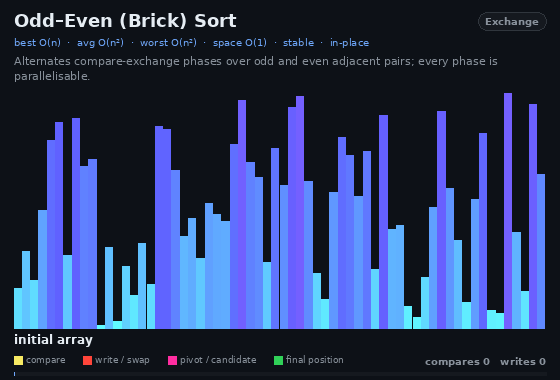

- **Time:** best O(n) · average O(n²) · worst O(n²)
- **Space:** O(1) · stable, in-place
- **Origin:** Habermann 1972; the basis of mesh-connected parallel sorting.

<a id="comb_sort"></a>
#### Comb Sort

Bubble sort with a shrinking gap (factor 1.3) so small values near the end move quickly.

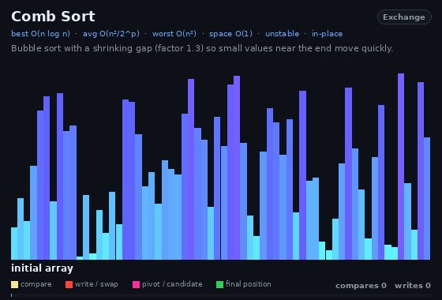

- **Time:** best O(n log n) · average O(n²/2^p) · worst O(n²)
- **Space:** O(1) · unstable, in-place
- **Origin:** Włodzimierz Dobosiewicz 1980; popularised by Lacey & Box, BYTE 1991.

<a id="gnome_sort"></a>
#### Gnome Sort

A garden gnome steps forward when in order and swaps backward when not.


- **Time:** best O(n) · average O(n²) · worst O(n²)
- **Space:** O(1) · stable, in-place
- **Origin:** Hamid Sarbazi-Azad 2000 ("stupid sort"); renamed by Dick Grune.

<a id="exchange_sort"></a>
#### Exchange Sort

Compares position i with every later position and swaps whenever they are inverted.


- **Time:** best O(n²) · average O(n²) · worst O(n²)
- **Space:** O(1) · unstable, in-place
- **Origin:** Folklore; the simplest quadratic sort to write down.

<a id="circle_sort"></a>
#### Circle Sort

Compares first with last, second with second-last, …, recurses on halves, repeats until clean.


- **Time:** best O(n log n) · average O(n log² n) · worst O(n log² n)
- **Space:** O(log n) · unstable, in-place
- **Origin:** Described by Gabriel Dabbs, 2014.

<a id="quick_sort"></a>
#### Quick Sort (Lomuto)

Partition around the last element with Lomuto's single-index scheme, then recurse.


- **Time:** best O(n log n) · average O(n log n) · worst O(n²)
- **Space:** O(log n) · unstable, in-place
- **Origin:** Tony Hoare 1959; Lomuto partition popularised by Bentley's Programming Pearls.

<a id="quick_sort_hoare"></a>
#### Quick Sort (Hoare)

Two indices converge from both ends around a middle pivot; fewer swaps than Lomuto.


- **Time:** best O(n log n) · average O(n log n) · worst O(n²)
- **Space:** O(log n) · unstable, in-place
- **Origin:** Hoare's original 1961 partition scheme.

<a id="quick_sort_3way"></a>
#### Quick Sort (3-way)

Dutch-national-flag partition into <, =, > pivot; linear time on inputs with few distinct keys.

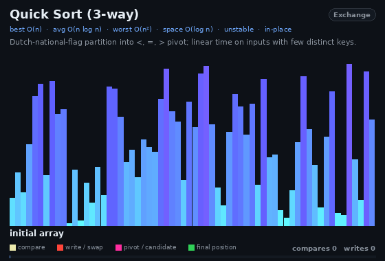

- **Time:** best O(n) · average O(n log n) · worst O(n²)
- **Space:** O(log n) · unstable, in-place
- **Origin:** Dijkstra's Dutch national flag problem (1976); Bentley–McIlroy 1993.

<a id="quick_sort_dual_pivot"></a>
#### Quick Sort (Dual-Pivot)

Two pivots split the range into three parts; the scheme used by Java's Arrays.sort for primitives.

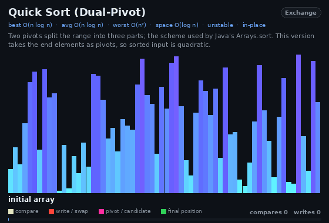

- **Time:** best O(n log n) · average O(n log n) · worst O(n²)
- **Space:** O(log n) · unstable, in-place
- **Origin:** Vladimir Yaroslavskiy, 2009.

<a id="stooge_sort"></a>
#### Stooge Sort

Sort the first 2/3, the last 2/3, then the first 2/3 again. Correct, and deliberately slow.

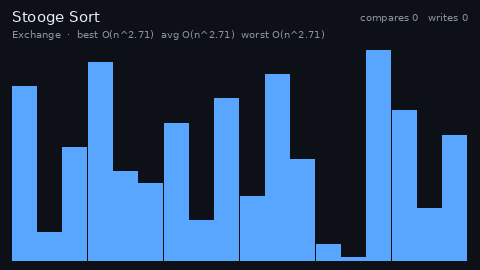

- **Time:** best O(n^2.71) · average O(n^2.71) · worst O(n^2.71)
- **Space:** O(log n) · unstable, in-place
- **Origin:** Howard, Fine and Howard — a Three Stooges joke, textbook cautionary example (CLRS problem 7-3).

<a id="slow_sort"></a>
#### Slow Sort

'Multiply and surrender': find the max of each half recursively, then sort the rest the same way.

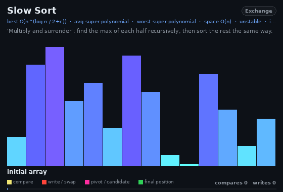

- **Time:** best Ω(n^(log n / 2+ε)) · average super-polynomial · worst super-polynomial
- **Space:** O(n) · unstable, in-place
- **Origin:** Broder & Stolfi, 'Pessimal Algorithms and Simplexity Analysis', 1986.

<a id="pancake_sort"></a>
#### Pancake Sort

Only prefix reversals ('spatula flips') are allowed: bring the max to the front, flip it into place.


- **Time:** best O(n) · average O(n²) · worst O(n²)
- **Space:** O(1) · unstable, in-place
- **Origin:** Gates & Papadimitriou 1979 (their only joint paper; Gates co-founded Microsoft).

### Selection

Repeatedly select an extreme element: selection, the heaps, cycle and tournament sorts.

<a id="selection_sort"></a>
#### Selection Sort

Repeatedly select the minimum of the unsorted suffix and swap it into place: exactly n−1 swaps.


- **Time:** best O(n²) · average O(n²) · worst O(n²)
- **Space:** O(1) · unstable, in-place
- **Origin:** Folklore; analysed in Knuth TAOCP vol. 3 §5.2.3.

<a id="double_selection_sort"></a>
#### Double Selection Sort

Each pass picks both the minimum and the maximum, halving the number of passes.


- **Time:** best O(n²) · average O(n²) · worst O(n²)
- **Space:** O(1) · unstable, in-place
- **Origin:** Common optimisation of selection sort (also 'bidirectional selection').

<a id="bingo_sort"></a>
#### Bingo Sort

Selection sort variant that moves every copy of the current maximum at once; fast with many duplicates.


- **Time:** best O(n + k·n) · average O(n·k) · worst O(n²)
- **Space:** O(1) · unstable, in-place
- **Origin:** Described in the NIST Dictionary of Algorithms and Data Structures.

<a id="cycle_sort"></a>
#### Cycle Sort

Rotates each permutation cycle into place; performs the theoretical minimum number of writes.


- **Time:** best O(n²) · average O(n²) · worst O(n²)
- **Space:** O(1) · unstable, in-place
- **Origin:** B. K. Haddon, 1990.

<a id="heap_sort"></a>
#### Heap Sort

Build a max-heap, then repeatedly swap the root to the end and restore the heap.

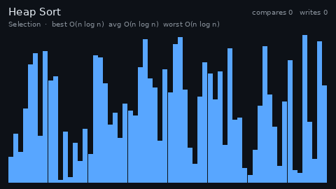

- **Time:** best O(n log n) · average O(n log n) · worst O(n log n)
- **Space:** O(1) · unstable, in-place
- **Origin:** J. W. J. Williams 1964; Floyd's linear-time heap construction the same year.

<a id="smooth_sort"></a>
#### Smooth Sort

Heap sort over a forest of Leonardo heaps; approaches O(n) on nearly sorted input.


- **Time:** best O(n) · average O(n log n) · worst O(n log n)
- **Space:** O(1) · unstable, in-place
- **Origin:** Edsger Dijkstra 1981 (EWD796a); this follows Orson Peters' formulation.

<a id="tournament_sort"></a>
#### Tournament Sort

Plays a knockout tournament to find the minimum, then replays only the winner's path per extraction.


- **Time:** best O(n log n) · average O(n log n) · worst O(n log n)
- **Space:** O(n) · stable, not in-place
- **Origin:** Knuth TAOCP vol. 3 §5.2.3 (replacement selection / tree selection).

<a id="weak_heap_sort"></a>
#### Weak Heap Sort

Heap sort on a weak heap (a binary tree with a reverse bit per node); near-optimal comparison count.

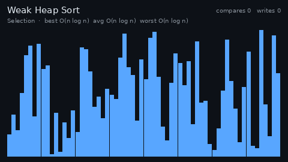

- **Time:** best O(n log n) · average O(n log n) · worst O(n log n)
- **Space:** O(n) bits · unstable, in-place
- **Origin:** Dutton 1993; Edelkamp & Wegener 2002.

### Insertion

Grow a sorted structure one element at a time: arrays, gapped arrays, trees and piles.

<a id="insertion_sort"></a>
#### Insertion Sort

Grow a sorted prefix by shifting larger elements right and dropping each new key into the gap.


- **Time:** best O(n) · average O(n²) · worst O(n²)
- **Space:** O(1) · stable, in-place
- **Origin:** Ancient (card-sorting by hand); analysed in Knuth TAOCP vol. 3.

<a id="binary_insertion_sort"></a>
#### Binary Insertion Sort

Insertion sort that binary-searches the sorted prefix: O(n log n) comparisons, same O(n²) moves.


- **Time:** best O(n log n) · average O(n²) · worst O(n²)
- **Space:** O(1) · stable, in-place
- **Origin:** Mauchly 1946 described binary insertion; used inside TimSort for short runs.

<a id="shell_sort"></a>
#### Shell Sort

Gapped insertion sorts with gaps n/2, n/4, …, 1 (Shell's original sequence).


- **Time:** best O(n log n) · average ~O(n^1.5) · worst O(n²)
- **Space:** O(1) · unstable, in-place
- **Origin:** Donald Shell, 1959 — the first algorithm to break the quadratic barrier.

<a id="shell_sort_ciura"></a>
#### Shell Sort (Ciura gaps)

Shell sort with Marcin Ciura's empirically optimal gap sequence 1, 4, 10, 23, 57, 132, 301, 701.

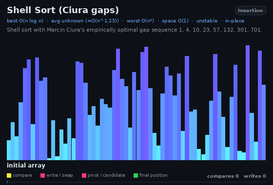

- **Time:** best O(n log n) · average unknown (≈O(n^1.25)) · worst O(n²)
- **Space:** O(1) · unstable, in-place
- **Origin:** Ciura 2001, 'Best Increments for the Average Case of Shell Sort'.

<a id="tree_sort"></a>
#### Tree Sort (BST)

Insert every key into an unbalanced binary search tree, then read it back in order.


- **Time:** best O(n log n) · average O(n log n) · worst O(n²)
- **Space:** O(n) · stable, not in-place
- **Origin:** Floyd 1962 and others; degenerates to a linked list on sorted input.

<a id="avl_tree_sort"></a>
#### AVL Tree Sort

Tree sort on a self-balancing AVL tree, so sorted input no longer degrades it.


- **Time:** best O(n log n) · average O(n log n) · worst O(n log n)
- **Space:** O(n) · stable, not in-place
- **Origin:** Adelson-Velsky & Landis, 1962.

<a id="patience_sort"></a>
#### Patience Sort

Deal cards onto piles (binary-searching the leftmost legal pile), then merge the piles.

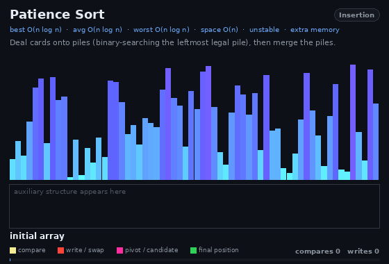

- **Time:** best O(n log n) · average O(n log n) · worst O(n log n)
- **Space:** O(n) · unstable, not in-place
- **Origin:** Named by Mallows 1960s after the card game; yields the longest increasing subsequence length for free.

### Merge

Combine sorted runs: classic merge sorts, in-place variants and run-based strand sort.

<a id="merge_sort"></a>
#### Merge Sort

Split in half, sort each half recursively, merge the two sorted halves.


- **Time:** best O(n log n) · average O(n log n) · worst O(n log n)
- **Space:** O(n) · stable, not in-place
- **Origin:** John von Neumann, 1945 (EDVAC) — one of the first programs ever written for a stored-program computer.

<a id="merge_sort_bottom_up"></a>
#### Merge Sort (Bottom-Up)

Iterative merge sort: merge runs of width 1, 2, 4, … with no recursion.


- **Time:** best O(n log n) · average O(n log n) · worst O(n log n)
- **Space:** O(n) · stable, not in-place
- **Origin:** Standard in external sorting and in Knuth's Algorithm S.

<a id="in_place_merge_sort"></a>
#### In-Place Merge Sort

Merges without a buffer by binary-searching a split point and rotating blocks (SymMerge-style).

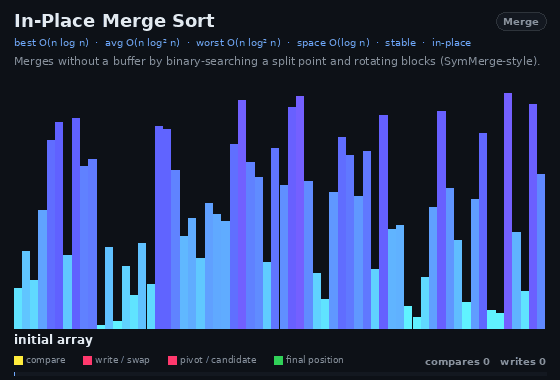

- **Time:** best O(n log n) · average O(n log² n) · worst O(n log² n)
- **Space:** O(log n) · stable, in-place
- **Origin:** Kim & Kutzner 2004 'Stable minimum storage merging by symmetric comparisons'; Go's sort.Stable.

<a id="strand_sort"></a>
#### Strand Sort

Repeatedly pull an increasing 'strand' out of the input and merge it into the output list.


- **Time:** best O(n) · average O(n²) · worst O(n²)
- **Space:** O(n) · stable, not in-place
- **Origin:** Described in Wikipedia/Knuth exercises; natural-merge flavour.

### Hybrid

Production sorts that stitch several strategies together.

<a id="tim_sort"></a>
#### Tim Sort

Detects natural runs, extends short ones with binary insertion, and merges them under stack invariants. (This version omits galloping mode.)


- **Time:** best O(n) · average O(n log n) · worst O(n log n)
- **Space:** O(n) · stable, not in-place
- **Origin:** Tim Peters 2002 for CPython; default sort in Python, Java (objects), Android, Rust (stable).

<a id="intro_sort"></a>
#### Intro Sort

Median-of-three quicksort that switches to heap sort past a depth limit and to insertion sort on tiny ranges.


- **Time:** best O(n log n) · average O(n log n) · worst O(n log n)
- **Space:** O(log n) · unstable, in-place
- **Origin:** David Musser, 1997; basis of C++ std::sort in libstdc++ and libc++.

### Distribution

Look at key values instead of comparing: counting, radix, bucket and friends. Compare counts are 0 because no element comparison is made.

<a id="counting_sort"></a>
#### Counting Sort

Count occurrences of each key, prefix-sum the counts into positions, place elements stably.


- **Time:** best O(n + k) · average O(n + k) · worst O(n + k)
- **Space:** O(n + k) · stable, not in-place
- **Origin:** Harold Seward, MIT 1954.

<a id="pigeonhole_sort"></a>
#### Pigeonhole Sort

Drop each element into the hole for its key, then read the holes back in order.


- **Time:** best O(n + k) · average O(n + k) · worst O(n + k)
- **Space:** O(n + k) · stable, not in-place
- **Origin:** Folklore variant of counting sort for keys with few gaps.

<a id="radix_sort_lsd"></a>
#### Radix Sort (LSD)

Stable counting-sort passes on each decimal digit, least significant first; negatives handled by offset.


- **Time:** best O(d(n + b)) · average O(d(n + b)) · worst O(d(n + b))
- **Space:** O(n + b) · stable, not in-place
- **Origin:** Herman Hollerith's tabulating machine, 1887; Seward's computer version 1954.

<a id="radix_sort_msd"></a>
#### Radix Sort (MSD)

Bucket by the most significant decimal digit, then recurse into each bucket on the next digit.


- **Time:** best O(n) · average O(d·n) · worst O(d·n)
- **Space:** O(n + b) · stable, not in-place
- **Origin:** Classic top-down radix sort; basis of burst/trie sorts for strings.

<a id="american_flag_sort"></a>
#### American Flag Sort

In-place MSD radix sort: count digits, then permute elements into their buckets by cycle-leader swaps.

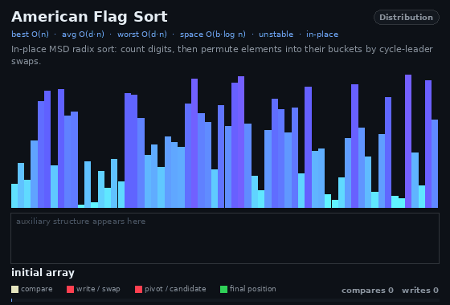

- **Time:** best O(n) · average O(d·n) · worst O(d·n)
- **Space:** O(b·log n) · unstable, in-place
- **Origin:** McIlroy, Bostic & McIlroy 1993, 'Engineering Radix Sort'.

<a id="bucket_sort"></a>
#### Bucket Sort

Scatter keys into n equal-width buckets over [min, max], insertion-sort each bucket, concatenate.


- **Time:** best O(n + k) · average O(n + k) · worst O(n²)
- **Space:** O(n + k) · stable, not in-place
- **Origin:** Isaac & Singleton 1956; Knuth TAOCP vol. 3 §5.2.1.

<a id="bead_sort"></a>
#### Bead (Gravity) Sort

Beads on rods fall under gravity; each row of beads is a number. S = sum of the inputs.


- **Time:** best O(n)–O(S) · average O(S) · worst O(S)
- **Space:** O(n·max) · stable, not in-place
- **Origin:** Joshua Arulanandham, Cristian Calude & Michael Dinneen, 2002.

<a id="flash_sort"></a>
#### Flash Sort

Classify keys into ~0.43n classes by linear interpolation, permute in place, finish with insertion sort.


- **Time:** best O(n) · average O(n) · worst O(n²)
- **Space:** O(m) · unstable, in-place
- **Origin:** Karl-Dietrich Neubert, 1998 (Dr. Dobb's).

<a id="sleep_sort"></a>
#### Sleep Sort (simulated)

Each element 'sleeps' for its value and is emitted on waking; here the clock is simulated tick by tick.


- **Time:** best O(n + max) · average O(n + max) · worst O(n + max)
- **Space:** O(n) · stable, not in-place
- **Origin:** Anonymous 4chan post, 2011 — a joke that is secretly a counting sort over time.

### Network

Data-independent comparator schedules, ideal for hardware and GPUs.

<a id="bitonic_sort"></a>
#### Bitonic Sort

Batcher's bitonic network: build ever-longer bitonic sequences, then merge them with half-cleaners.


- **Time:** best O(n log² n) · average O(n log² n) · worst O(n log² n)
- **Space:** O(1) · unstable, in-place
- **Origin:** Ken Batcher, 1968; the workhorse of GPU sorting. Arbitrary n handled by skipping out-of-range comparators.

<a id="odd_even_merge_sort"></a>
#### Batcher Odd–Even Merge Sort

Batcher's other network: recursively merge sorted halves with an odd–even merge.

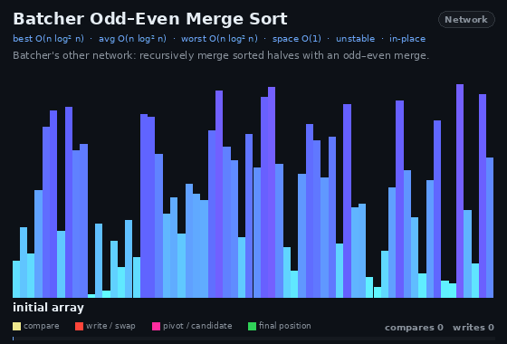

- **Time:** best O(n log² n) · average O(n log² n) · worst O(n log² n)
- **Space:** O(1) · unstable, in-place
- **Origin:** Ken Batcher, 1968; Knuth TAOCP vol. 3 §5.3.4.

### Probabilistic

Randomised sorts with no worst-case bound. Included as cautionary tales.

<a id="bogo_sort"></a>
#### Bogo Sort

Shuffle until sorted. Guarded by max_shuffles so it always terminates.

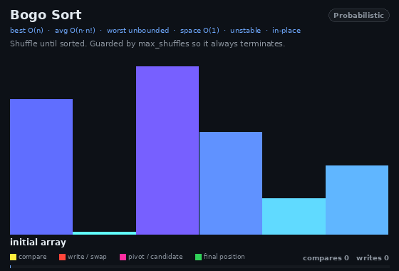

- **Time:** best O(n) · average O(n·n!) · worst unbounded
- **Space:** O(1) · unstable, in-place
- **Origin:** Jargon-file folklore ('permutation sort', 'stupid sort').

<a id="bozo_sort"></a>
#### Bozo Sort

Swap two random elements, check, repeat. Even less strategic than bogo sort.


- **Time:** best O(n) · average O(n·n!) · worst unbounded
- **Space:** O(1) · unstable, in-place
- **Origin:** Jargon-file folklore.

<!-- END:GALLERY -->

---

## Other languages

| Language | Location | Status |
| --- | --- | --- |
| Python | `python/` | **Reference.** 48 algorithms, tracing, tests, benchmarks. |
| C | `c/` | 28 algorithms (the original catalogue) → `libsort.a`; build with `cd c && make`. |
| Go | `go/` | 28 algorithms; `cd go && go run ./cmd`. |
| Rust | `rust/` | 28 algorithms; `cd rust && cargo run`. |
| x86-64 assembly | `assembly/` | Hand-written cores for 8 algorithms, C tail-calls for the rest (see `assembly/README.md`). |

All C, Go and Rust ports are covered by their own test suites (`make test`, `go test ./...`, `cargo test`), which check random, sorted, reversed and duplicate-heavy inputs of many lengths (the C suite is also clean under AddressSanitizer). Some ports are deliberately simplified relative to Python: for example the Go/Rust `tim_sort` is a fixed-minrun bottom-up hybrid rather than a full run-detecting TimSort. The 20 algorithms added in v1.1 exist in Python only.

## Repository layout

```
python/sorting_algorithms/   base.py (tracking array + registry) and algos/<family>.py
python/tests/                correctness, stability, networks, docs-consistency
visualizations/              GIF renderer and generated gifs/
benchmarks/                  measurement + report generator
report/                      raw data and figures used by REPORT.md
c/  go/  rust/  assembly/    ports of the original catalogue
```

## Contributing a new algorithm

1. Add a function decorated with `@algorithm(...)` in the right `python/sorting_algorithms/algos/<family>.py`, written against the `Tracked` API (`a[i]`, `a[i] = v`, `a.swap(i, j)`, `a.show(...)`, `a.commit(...)`).
2. `python -m pytest` — it is automatically picked up by every test.
3. Regenerate its GIF, then `python scripts/build_docs.py`.

## License & citation

MIT — see [LICENSE](LICENSE). Citation metadata is in [CITATION.cff](CITATION.cff).
