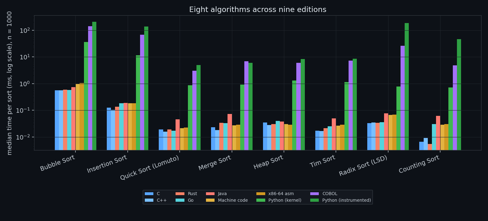

# Sorting Algorithms: Empirical Study

*Generated by `benchmarks/generate_report.py` from `report/data/benchmarks.json`.
Python 3.14.10, Linux-7.2.15+deb14-amd64-x86_64-with-glibc2.43.*

## 1. Summary

We implemented 56 sorting algorithms in a single instrumented framework, verified them against Python's `sorted()`
(random, sorted, reversed, duplicate-heavy and tiny inputs; stability; 0-1 principle for networks) and measured each on
5 input shapes at sizes n = 16 … 2048.

Headline results at n = 1024 (random permutation):

- **Fewest comparisons:** Merge-Insertion Sort (Ford–Johnson) with 8,798, i.e. 1.00× the information-theoretic minimum ⌈log₂ n!⌉ = 8,770.
- **Fewest writes:** Cycle Sort (1,024 writes).
- **Fastest wall-clock in Python:** Pigeonhole Sort (0.53 ms); see §5 for why this ranking differs from the operation counts.
- **Input shape matters enormously:** Lomuto quicksort uses 11,403 comparisons on random data but 523,776 on sorted data (**46×**), while 3-way quicksort needs 6,400 instead of 55,005 on 10-valued data (**8.6× fewer**).

## 2. Method

**Instrumentation.** Algorithms operate on a `Tracked` array; every element is wrapped so each `<`, `<=`, `>`, `>=`, `==` is counted, and every
`a[i] = v` or `swap` counts as a write (a swap is two). Counts are therefore exact and machine-independent.
Distribution sorts (counting, radix, bucket, …) never compare elements, so they report 0 comparisons and are ranked by writes and
runtime. Out-of-place algorithms that build an auxiliary structure (tree, patience, tournament, strand, counting, …) report only
the final copy-back as writes (n), so *their write counts understate memory traffic*; treat write rankings with that caveat.

**Inputs.** `random` (permutation of 0..n−1), `sorted`, `reversed`, `nearly_sorted` (sorted with n/20 random swaps), `few_unique`
(10 distinct values). Seeds are fixed. Sizes are powers of two from 16 to 2048; super-polynomial sorts
(Stooge, Slow, Bogo, Bozo, Permutation) are capped (Stooge ≤ 128, Slow ≤ 24, Bogo ≤ 7, Bozo ≤ 6, Permutation ≤ 8) and the factorial-time ones are averaged over 12 trials.

**Runtime.** Median of 3 runs of the instrumented-but-untraced code path. This is *Python* time with per-comparison object
overhead — useful for relative comparison, not a statement about C performance.

## 3. Comparison efficiency


Algorithms are split by measured slope on the log-log axes (left: quadratic, right: everything else); only the five most and three least expensive in each panel are labelled. Colour encodes family.

### Fewest comparisons at n = 1024 (random)

| Rank | Algorithm | Comparisons | × lower bound | Writes |
|---|:-:|:-:|:-:|:-:|
| 1 | Merge-Insertion Sort (Ford–Johnson) | 8,798 | 1.00 | 1,024 |
| 2 | Binary Insertion Sort | 8,839 | 1.01 | 262,490 |
| 3 | Tim Sort | 8,929 | 1.02 | 13,983 |
| 4 | Tournament Sort | 8,938 | 1.02 | 1,024 |
| 5 | Library Sort (Gapped Insertion) | 8,938 | 1.02 | 1,024 |
| 6 | Merge Sort | 8,938 | 1.02 | 9,599 |
| 7 | Merge Sort (Bottom-Up) | 8,938 | 1.02 | 9,599 |
| 8 | AVL Tree Sort | 9,010 | 1.03 | 1,024 |
| 9 | In-Place Merge Sort | 9,375 | 1.07 | 44,502 |
| 10 | Weak Heap Sort | 9,756 | 1.11 | 12,634 |
| 11 | Quick Sort (Dual-Pivot) | 10,627 | 1.21 | 7,630 |
| 12 | Bottom-Up Heap Sort | 10,709 | 1.22 | 11,781 |

### Fewest writes at n = 1024 (random), in-place algorithms

Out-of-place sorts are excluded because their counted writes are just the final copy-back (see §2).

| Rank | Algorithm | Writes | Comparisons |
|---|:-:|:-:|:-:|
| 1 | Cycle Sort | 1,024 | 1,564,854 |
| 2 | Selection Sort | 2,038 | 523,776 |
| 3 | Double Selection Sort | 2,038 | 521,378 |
| 4 | Bingo Sort | 2,038 | 1,048,574 |
| 5 | Flash Sort | 2,706 | 0 |
| 6 | Quick Sort (Hoare) | 4,802 | 14,558 |
| 7 | American Flag Sort | 5,066 | 0 |
| 8 | Intro Sort | 6,023 | 11,186 |
| 9 | Quick Sort (Dual-Pivot) | 7,630 | 10,627 |
| 10 | Comb Sort | 9,210 | 22,237 |


## 4. Input sensitivity


Operations ÷ (n·log₂ n) for every algorithm and input shape. Values near 1 mean "about as many operations as the n log n ideal";
dark cells are algorithms that handle that shape gracefully; bright cells indicate quadratic behaviour.

### Adaptivity (comparison-based algorithms; ratio of operations to the random-input cost)

| Algorithm | Sorted ÷ random | Reversed ÷ random | Nearly-sorted ÷ random | Few-unique ÷ random |
|---|:-:|:-:|:-:|:-:|
| Gnome Sort | 0.00 | 2.00 | 0.12 | 0.89 |
| Bubble Sort | 0.00 | 1.50 | 0.56 | 0.94 |
| Odd–Even (Brick) Sort | 0.00 | 1.52 | 0.52 | 0.90 |
| Insertion Sort | 0.00 | 2.00 | 0.13 | 0.89 |
| Cocktail Shaker Sort | 0.00 | 1.70 | 0.13 | 0.92 |
| Binary Insertion Sort | 0.03 | 1.97 | 0.15 | 0.90 |
| Tim Sort | 0.04 | 0.09 | 0.63 | 0.94 |
| Strand Sort | 0.05 | 12.03 | 0.33 | 0.18 |
| Circle Sort | 0.07 | 0.16 | 0.82 | 0.69 |
| Smooth Sort | 0.09 | 0.90 | 0.21 | 0.89 |
| Cartesian Tree Sort | 0.16 | 0.16 | 0.94 | 1.00 |
| Shell Sort | 0.20 | 0.51 | 0.50 | 0.47 |
| Shell Sort (Ciura gaps) | 0.29 | 0.66 | 0.74 | 0.53 |
| Cycle Sort | 0.33 | 0.59 | 0.36 | 0.87 |
| In-Place Merge Sort | 0.37 | 0.81 | 0.58 | 0.86 |
| Pancake Sort | 0.40 | 0.40 | 0.54 | 0.90 |
| Batcher Odd–Even Merge Sort | 0.47 | 0.67 | 0.76 | 0.75 |
| Intro Sort | 0.48 | 0.54 | 0.53 | 0.83 |
| Pairwise Sorting Network | 0.48 | 0.69 | 0.72 | 0.67 |
| Bitonic Sort | 0.50 | 1.50 | 0.76 | 0.77 |
| Exchange Sort | 0.50 | 1.50 | 0.56 | 0.51 |
| Merge Sort | 0.55 | 0.83 | 0.84 | 0.97 |
| Merge Sort (Bottom-Up) | 0.55 | 0.83 | 0.84 | 0.97 |
| Quick Sort (Hoare) | 0.58 | 0.63 | 0.60 | 1.12 |
| Comb Sort | 0.61 | 0.75 | 0.86 | 0.76 |
| Tournament Sort | 0.62 | 0.62 | 0.88 | 0.98 |
| Quick Sort (3-way) | 0.72 | 0.71 | 0.76 | 0.35 |
| Weak Heap Sort | 0.78 | 0.83 | 0.80 | 0.73 |
| Enumeration (Rank) Sort | 0.80 | 1.20 | 0.83 | 1.02 |
| Merge-Insertion Sort (Ford–Johnson) | 0.91 | 0.91 | 0.93 | 0.98 |
| Selection Sort | 1.00 | 1.00 | 1.00 | 1.00 |
| Bingo Sort | 1.00 | 1.00 | 1.00 | 0.01 |
| Double Selection Sort | 1.00 | 0.50 | 1.00 | 1.00 |
| AVL Tree Sort | 1.02 | 1.02 | 1.09 | 1.04 |
| Bottom-Up Heap Sort | 1.03 | 0.99 | 1.03 | 1.01 |
| Heap Sort | 1.06 | 0.93 | 1.05 | 0.92 |
| Ternary Heap Sort | 1.06 | 0.97 | 1.06 | 0.93 |
| Library Sort (Gapped Insertion) | 1.31 | 1.21 | 1.18 | 1.15 |
| Patience Sort | 1.37 | 0.14 | 1.39 | 0.66 |
| Quick Sort (Lomuto) | 21.91 | 21.95 | 2.31 | 2.46 |
| Quick Sort (Dual-Pivot) | 28.69 | 28.75 | 2.85 | 3.23 |
| Tree Sort (BST) | 41.57 | 41.57 | 3.91 | 4.61 |

Reading the table: a ratio far below 1 on `sorted` marks an adaptive algorithm (insertion, bubble, gnome, Tim, smooth, …); a ratio above 1 on `sorted`
or `reversed` marks an algorithm with a degenerate case (Lomuto and dual-pivot quicksort with fixed end pivots, unbalanced tree sort).

## 5. Wall-clock time (Python)

| Rank | Algorithm | ms (n=1024) | Comparisons | Writes |
|---|:-:|:-:|:-:|:-:|
| 1 | Pigeonhole Sort | 0.53 | 0 | 1,024 |
| 2 | Counting Sort | 0.63 | 0 | 1,024 |
| 3 | Flash Sort | 1.44 | 0 | 2,706 |
| 4 | Radix Sort (LSD) | 2.27 | 0 | 1,024 |
| 5 | Quick Sort (Dual-Pivot) | 5.00 | 10,627 | 7,630 |
| 6 | Intro Sort | 5.38 | 11,186 | 6,023 |
| 7 | Weak Heap Sort | 6.50 | 9,756 | 12,634 |
| 8 | Quick Sort (Hoare) | 6.68 | 14,558 | 4,802 |
| 9 | Merge Sort (Bottom-Up) | 6.83 | 8,938 | 9,599 |
| 10 | American Flag Sort | 7.25 | 0 | 5,066 |
| 11 | Shell Sort (Ciura gaps) | 7.70 | 13,389 | 10,494 |
| 12 | Tim Sort | 8.02 | 8,929 | 13,983 |
| 13 | Bottom-Up Heap Sort | 8.46 | 10,709 | 11,781 |
| 14 | Quick Sort (3-way) | 8.54 | 18,020 | 14,110 |
| 15 | Ternary Heap Sort | 8.77 | 16,842 | 12,914 |
| 16 | Bucket Sort | 8.82 | 0 | 1,024 |
| 17 | Comb Sort | 9.80 | 22,237 | 9,210 |
| 18 | In-Place Merge Sort | 12.56 | 9,375 | 44,502 |
| 19 | Strand Sort | 12.77 | 42,690 | 1,024 |
| 20 | Quick Sort (Lomuto) | 13.26 | 11,403 | 12,506 |
| 21 | Pairwise Sorting Network | 14.83 | 24,063 | 25,678 |
| 22 | Shell Sort | 14.92 | 25,418 | 20,771 |
| 23 | Batcher Odd–Even Merge Sort | 18.16 | 24,063 | 27,338 |
| 24 | Merge Sort | 21.93 | 8,938 | 9,599 |
| 25 | Heap Sort | 28.25 | 17,308 | 18,654 |
| 26 | Sleep Sort (simulated) | 40.68 | 0 | 1,024 |
| 27 | Smooth Sort | 43.37 | 22,696 | 13,025 |
| 28 | Bitonic Sort | 45.81 | 28,160 | 28,186 |
| 29 | Tree Sort (BST) | 45.97 | 11,600 | 1,024 |
| 30 | Circle Sort | 51.20 | 51,200 | 17,398 |
| 31 | Merge-Insertion Sort (Ford–Johnson) | 72.52 | 8,798 | 1,024 |
| 32 | Binary Insertion Sort | 81.18 | 8,839 | 262,490 |
| 33 | Bead (Gravity) Sort | 118.02 | 0 | 1,024 |
| 34 | Cartesian Tree Sort | 127.18 | 11,739 | 1,024 |
| 35 | Radix Sort (MSD) | 127.19 | 0 | 1,024 |
| 36 | Library Sort (Gapped Insertion) | 127.28 | 8,938 | 1,024 |
| 37 | Patience Sort | 160.48 | 13,755 | 1,024 |
| 38 | Selection Sort | 196.87 | 523,776 | 2,038 |
| 39 | Double Selection Sort | 206.64 | 521,378 | 2,038 |
| 40 | Cocktail Shaker Sort | 226.45 | 400,023 | 522,942 |
| 41 | Tournament Sort | 239.17 | 8,938 | 1,024 |
| 42 | Exchange Sort | 249.20 | 523,776 | 522,942 |
| 43 | Odd–Even (Brick) Sort | 252.33 | 509,454 | 522,942 |
| 44 | Bubble Sort | 256.51 | 523,311 | 522,942 |
| 45 | Gnome Sort | 268.79 | 523,958 | 522,942 |
| 46 | Enumeration (Rank) Sort | 270.07 | 1,310,047 | 1,024 |
| 47 | AVL Tree Sort | 288.32 | 9,010 | 1,024 |
| 48 | Bingo Sort | 294.56 | 1,048,574 | 2,038 |
| 49 | Pancake Sort | 299.46 | 523,776 | 777,354 |
| 50 | Cycle Sort | 438.00 | 1,564,854 | 1,024 |
| 51 | Insertion Sort | 634.48 | 262,487 | 262,490 |


In CPython the cost of an operation is dominated by interpreter overhead, so algorithms with fewer, simpler Python-level steps (the
bucket/counting/radix family working on plain integers) beat theoretically superior comparison sorts, and anything that allocates
auxiliary lists and wraps elements pays for it. Do not read this table as a prediction for compiled languages.

## 6. Empirical growth exponents

We fitted ops ≈ c·nᵖ over n = 64 … 2048 on random input.


| Algorithm | Fitted p | Claimed average |
|---|:-:|:-:|
| Counting Sort | 1.00 | O(n + k) |
| Pigeonhole Sort | 1.00 | O(n + k) |
| Radix Sort (LSD) | 1.00 | O(d(n + b)) |
| Radix Sort (MSD) | 1.00 | O(d·n) |
| Bucket Sort | 1.00 | O(n + k) |
| Bead (Gravity) Sort | 1.00 | O(S) |
| Sleep Sort (simulated) | 1.00 | O(n + max) |
| Flash Sort | 1.00 | O(n) |
| Quick Sort (Hoare) | 1.14 | O(n log n) |
| Patience Sort | 1.14 | O(n log n) |
| Tim Sort | 1.15 | O(n log n) |
| Cartesian Tree Sort | 1.15 | O(n log n) |
| Weak Heap Sort | 1.16 | O(n log n) |
| Quick Sort (3-way) | 1.16 | O(n log n) |
| Bottom-Up Heap Sort | 1.16 | O(n log n) |
| Intro Sort | 1.18 | O(n log n) |
| Library Sort (Gapped Insertion) | 1.18 | O(n log n) expected |
| Tournament Sort | 1.18 | O(n log n) |
| Merge-Insertion Sort (Ford–Johnson) | 1.18 | O(n log n) |
| AVL Tree Sort | 1.18 | O(n log n) |
| Ternary Heap Sort | 1.19 | O(n log n) |
| American Flag Sort | 1.19 | O(d·n) |
| Merge Sort | 1.19 | O(n log n) |
| Merge Sort (Bottom-Up) | 1.19 | O(n log n) |
| Heap Sort | 1.20 | O(n log n) |
| Tree Sort (BST) | 1.21 | O(n log n) |
| Quick Sort (Dual-Pivot) | 1.22 | O(n log n) |
| Shell Sort (Ciura gaps) | 1.23 | unknown (≈O(n^1.25)) |
| Comb Sort | 1.24 | O(n²/2^p) |
| Smooth Sort | 1.24 | O(n log n) |
| Quick Sort (Lomuto) | 1.26 | O(n log n) |
| Bitonic Sort | 1.33 | O(n log² n) |
| In-Place Merge Sort | 1.33 | O(n log² n) |
| Pairwise Sorting Network | 1.33 | O(n log² n) |
| Circle Sort | 1.34 | O(n log² n) |
| Batcher Odd–Even Merge Sort | 1.34 | O(n log² n) |
| Shell Sort | 1.45 | ~O(n^1.5) |
| Strand Sort | 1.51 | O(n²) |
| Binary Insertion Sort | 1.93 | O(n²) |
| Selection Sort | 1.99 | O(n²) |
| Bingo Sort | 1.99 | O(n·k) |
| Double Selection Sort | 1.99 | O(n²) |
| Enumeration (Rank) Sort | 2.00 | O(n²) |
| Insertion Sort | 2.00 | O(n²) |
| Cocktail Shaker Sort | 2.01 | O(n²) |
| Pancake Sort | 2.01 | O(n²) |
| Exchange Sort | 2.01 | O(n²) |
| Cycle Sort | 2.01 | O(n²) |
| Gnome Sort | 2.01 | O(n²) |
| Bubble Sort | 2.02 | O(n²) |
| Odd–Even (Brick) Sort | 2.02 | O(n²) |

Caveats: over this range n log n appears as p ≈ 1.1–1.25 and quadratic sorts as p ≈ 2. For the distribution sorts and the out-of-place tree/patience/tournament/strand sorts the
fit only reflects *counted* operations (comparisons + writes); work that the counters do not see — walking a count array of size k, dropping beads on n·max cells,
ticking a simulated clock — is not included, so their p ≈ 1 understates their true cost (bead sort is Θ(S), not Θ(n)). Ordering within a tight cluster (e.g. 1.14 vs 1.19) is not significant.

## 7. Pathological algorithms

| Algorithm | Largest n tried | Comparisons | Writes | ms |
|---|:-:|:-:|:-:|:-:|
| Stooge Sort | 128 | 265,720 | 7,448 | 136.7 |
| Slow Sort | 16 | 406 | 132 | 0.3 |
| Bogo Sort | 7 | 8,781 | 45,064 | 16.4 |
| Bozo Sort | 6 | 1,756 | 1,728 | 1.5 |
| Permutation Sort | 8 | 27,870 | 8 | 20.1 |

These algorithms are included for completeness: their cost explodes super-polynomially (Stooge ≈ n^2.7, Slow sort worse than any polynomial,
Bogo/Bozo/Permutation factorial), which is why they are capped.

## 8. Threats to validity

- Single machine, single Python version; wall-clock numbers vary. Operation counts are exact.
- One seed per (n, distribution) for deterministic algorithms; random pivots are not used anywhere.
- Python's `sorted()` (Timsort in C) is not part of the comparison; the pure-Python `tim_sort` here omits galloping mode.
- Distribution sorts are given integer keys in a range proportional to n; with huge key ranges (k ≫ n) counting/pigeonhole/bead/sleep sorts degrade, as their complexity predicts.
- Write counts exclude auxiliary buffers, as noted in §2.

## 9. Reproducing

```sh
export PYTHONPATH=$PWD/python
python benchmarks/run_benchmarks.py && python benchmarks/generate_report.py
```

## 10. Cross-language speed comparison

The same algorithms on the same deterministic data (n = 1000 values in 0..9999; smaller n for the super-polynomial sorts) in every edition,
on AMD Ryzen 7 5700U with Radeon Graphics (Linux-7.2.15+deb14-amd64-x86_64-with-glibc2.43). Each value is the median time of one `sort()` call. Reproduce with `benchmarks/compare_languages.py`
and `benchmarks/language_charts.py`.


| Edition | Geometric mean vs C | Median vs C | Fastest on (of 52) | Toolchain |
|---|:-:|:-:|:-:|---|
| C | 1.00× | 1.00× | 15 | gcc (Debian 16.2.0-4) 16.2.0 -O2 |
| C++ | 1.00× | 1.00× | 17 | g++ (Debian 16.2.0-4) 16.2.0 -O2 |
| Rust | 1.05× | 1.02× | 12 | rustc 1.98.1 (48a229cea 2026-09-01) --release |
| Go | 1.29× | 1.26× | 5 | go version go1.26.5 linux/amd64 |
| Java | 1.73× | 1.47× | 0 | openjdk version "25.0.5" 2026-10-20 (JIT, 20 warm-up runs) |
| Machine code | 2.17× | 2.15× | 2 | raw x86-64 images loaded into executable memory |
| x86-64 asm | 2.17× | 2.16× | 2 | GNU as (hand-written 28 + compiled 28), timed through a C harness |
| Python (kernel) | 45.40× | 41.33× | 0 | CPython 3.14.10, plain kernels |
| COBOL | 351.82× | 307.98× | 0 | cobc (GnuCOBOL) 3.2.0 -O2 (process-timed) |
| Python (instrumented) | 448.94× | 296.20× | 0 | CPython 3.14.10, tracing reference implementation (counts every compare/write) |
| ↳ asm, hand-written (27 algorithms) | 1.25× | | | hand-written |
| ↳ asm, compiler-generated | 3.93× | | | `kernels/backends/x86.py` |

### Representative algorithms (median ms per sort)

| Algorithm | C | C++ | Rust | Go | Java | Machine code | x86-64 asm | Python (kernel) | COBOL | Python (instrumented) |
|---|---:|---:|---:|---:|---:|---:|---:|---:|---:|---:|
| Bubble Sort | 0.553 | 0.557 | 0.593 | 0.584 | 0.737 | 0.985 | 1.041 | 36.1 | 140.9 | 209.2 |
| Insertion Sort | 0.124 | 0.103 | 0.136 | 0.184 | 0.188 | 0.184 | 0.185 | 11.5 | 68.1 | 139.3 |
| Selection Sort | 0.926 | 0.926 | 0.411 | 0.404 | 0.324 | 0.285 | 0.287 | 12.2 | 58.9 | 175.5 |
| Shell Sort | 0.039 | 0.042 | 0.039 | 0.043 | 0.046 | 0.042 | 0.042 | 0.931 | 4.538 | 8.133 |
| Heap Sort | 0.035 | 0.028 | 0.030 | 0.040 | 0.038 | 0.030 | 0.028 | 1.308 | 6.045 | 8.380 |
| Merge Sort | 0.023 | 0.018 | 0.034 | 0.033 | 0.072 | 0.027 | 0.029 | 0.926 | 6.876 | 6.038 |
| Quick Sort (Lomuto) | 0.019 | 0.016 | 0.019 | 0.017 | 0.046 | 0.021 | 0.022 | 0.866 | 3.021 | 4.974 |
| Intro Sort | 0.010 | 0.011 | 0.015 | 0.017 | 0.040 | 0.016 | 0.016 | 0.529 | 2.898 | 4.146 |
| Tim Sort | 0.017 | 0.017 | 0.021 | 0.025 | 0.050 | 0.027 | 0.028 | 1.138 | 7.360 | 8.540 |
| Radix Sort (LSD) | 0.033 | 0.034 | 0.034 | 0.036 | 0.077 | 0.068 | 0.068 | 0.773 | 26.3 | 187.6 |
| Counting Sort | 0.007 | 0.009 | 0.005 | 0.030 | 0.061 | 0.028 | 0.030 | 0.722 | 4.794 | 46.7 |
| Bitonic Sort | 0.187 | 0.188 | 0.082 | 0.188 | 0.204 | 0.109 | 0.085 | 4.659 | 101.8 | 14.3 |





### All algorithms (median ms per sort; n in parentheses)

| Algorithm (n) | C | C++ | Rust | Go | Java | Machine code | x86-64 asm | Python (kernel) | COBOL | Python (instrumented) |
|---|---:|---:|---:|---:|---:|---:|---:|---:|---:|---:|
| American Flag Sort (1000) | 0.062 | 0.073 | 0.077 | 0.088 | 0.099 | 6.251 | 7.197 | 1.536 | 302.5 | 2.657 |
| AVL Tree Sort (1000) | 0.081 | 0.073 | 0.124 | 0.108 | 0.111 | 0.281 | 0.282 | 4.485 | 29.0 | 44.3 |
| Bead (Gravity) Sort (1000) | 1.172 | 1.178 | 3.232 | 2.670 | 2.987 | 2.505 | 2.494 | 238.9 | 1569.7 | 498.2 |
| Binary Insertion Sort (1000) | 0.046 | 0.046 | 0.134 | 0.213 | 0.136 | 0.161 | 0.105 | 10.5 | 68.0 | 68.9 |
| Bingo Sort (1000) | 0.335 | 0.336 | 0.498 | 0.288 | 0.420 | 0.872 | 0.859 | 19.0 | 88.4 | 236.6 |
| Bitonic Sort (1000) | 0.187 | 0.188 | 0.082 | 0.188 | 0.204 | 0.109 | 0.085 | 4.659 | 101.8 | 14.3 |
| Bottom-Up Heap Sort (1000) | 0.061 | 0.056 | 0.062 | 0.067 | 0.069 | 0.281 | 0.285 | 2.538 | 99.3 | 7.559 |
| Bubble Sort (1000) | 0.553 | 0.557 | 0.593 | 0.584 | 0.737 | 0.985 | 1.041 | 36.1 | 140.9 | 209.2 |
| Bucket Sort (1000) | 0.011 | 0.012 | 0.011 | 0.016 | 0.042 | 0.020 | 0.018 | 0.445 | 4.680 | 61.8 |
| Cartesian Tree Sort (1000) | 0.042 | 0.039 | 0.021 | 0.057 | 0.078 | 0.128 | 0.129 | 1.525 | 13.9 | 30.9 |
| Circle Sort (1000) | 0.116 | 0.111 | 0.123 | 0.140 | 0.187 | 0.309 | 0.313 | 6.252 | 50.0 | 26.1 |
| Cocktail Shaker Sort (1000) | 0.612 | 0.611 | 0.527 | 0.551 | 0.541 | 0.766 | 0.656 | 33.9 | 121.1 | 176.0 |
| Comb Sort (1000) | 0.035 | 0.037 | 0.031 | 0.033 | 0.050 | 0.040 | 0.040 | 1.543 | 7.553 | 8.880 |
| Counting Sort (1000) | 0.007 | 0.009 | 0.005 | 0.030 | 0.061 | 0.028 | 0.030 | 0.722 | 4.794 | 46.7 |
| Cycle Sort (1000) | 0.811 | 0.827 | 0.527 | 1.477 | 1.113 | 1.640 | 1.656 | 38.3 | 118.8 | 381.8 |
| Double Selection Sort (1000) | 0.165 | 0.213 | 0.280 | 0.320 | 0.222 | 0.611 | 0.605 | 11.6 | 72.3 | 172.4 |
| Enumeration (Rank) Sort (1000) | 1.766 | 1.680 | 1.526 | 1.850 | 1.744 | 3.120 | 3.020 | 39.2 | 200.3 | 220.1 |
| Exchange Sort (1000) | 0.808 | 0.801 | 0.731 | 0.720 | 0.759 | 1.399 | 1.316 | 25.8 | 85.3 | 214.2 |
| Flash Sort (1000) | 0.015 | 0.017 | 0.016 | 0.017 | 0.026 | 0.041 | 0.042 | 0.412 | 4.907 | 1.367 |
| Merge-Insertion Sort (Ford–Johnson) (1000) | 0.153 | 0.156 | 0.372 | 0.503 | 0.720 | 1.451 | 1.466 | 29.2 | 172.3 | 21.0 |
| Gnome Sort (1000) | 1.426 | 1.645 | 0.613 | 0.491 | 0.684 | 0.664 | 0.662 | 40.7 | 146.2 | 225.4 |
| Heap Sort (1000) | 0.035 | 0.028 | 0.030 | 0.040 | 0.038 | 0.030 | 0.028 | 1.308 | 6.045 | 8.380 |
| In-Place Merge Sort (1000) | 0.081 | 0.079 | 0.093 | 0.100 | 0.103 | 0.224 | 0.224 | 4.022 | 33.0 | 10.3 |
| Insertion Sort (1000) | 0.124 | 0.103 | 0.136 | 0.184 | 0.188 | 0.184 | 0.185 | 11.5 | 68.1 | 139.3 |
| Intro Sort (1000) | 0.010 | 0.011 | 0.015 | 0.017 | 0.040 | 0.016 | 0.016 | 0.529 | 2.898 | 4.146 |
| Library Sort (Gapped Insertion) (1000) | 0.094 | 0.094 | 0.089 | 0.101 | 0.225 | 0.212 | 0.213 | 2.982 | 32.0 | 28.0 |
| Merge Sort (1000) | 0.023 | 0.018 | 0.034 | 0.033 | 0.072 | 0.027 | 0.029 | 0.926 | 6.876 | 6.038 |
| Merge Sort (Bottom-Up) (1000) | 0.022 | 0.022 | 0.028 | 0.031 | 0.087 | 0.066 | 0.067 | 0.898 | 4.885 | 5.627 |
| Batcher Odd–Even Merge Sort (1000) | 0.184 | 0.185 | 0.186 | 0.185 | 0.190 | 0.233 | 0.233 | 5.691 | 99.5 | 14.9 |
| Odd–Even (Brick) Sort (1000) | 0.623 | 0.574 | 0.493 | 0.444 | 0.580 | 0.454 | 0.420 | 42.3 | 156.9 | 208.9 |
| Pairwise Sorting Network (1000) | 0.068 | 0.065 | 0.068 | 0.060 | 0.085 | 0.187 | 0.187 | 3.338 | 15.6 | 12.4 |
| Pancake Sort (1000) | 1.123 | 1.121 | 0.662 | 0.863 | 0.721 | 0.471 | 0.616 | 43.1 | 155.2 | 257.2 |
| Patience Sort (1000) | 0.096 | 0.090 | 0.105 | 0.127 | 0.135 | 0.095 | 0.130 | 3.913 | 30.9 | 30.8 |
| Pigeonhole Sort (1000) | 0.010 | 0.012 | 0.007 | 0.019 | 0.051 | 0.028 | 0.031 | 0.373 | 2.050 | 551.9 |
| Quick Sort (Lomuto) (1000) | 0.019 | 0.016 | 0.019 | 0.017 | 0.046 | 0.021 | 0.022 | 0.866 | 3.021 | 4.974 |
| Quick Sort (3-way) (1000) | 0.022 | 0.017 | 0.027 | 0.029 | 0.031 | 0.061 | 0.061 | 1.209 | 5.699 | 7.014 |
| Quick Sort (Dual-Pivot) (1000) | 0.010 | 0.010 | 0.010 | 0.011 | 0.013 | 0.036 | 0.036 | 0.603 | 2.450 | 4.029 |
| Quick Sort (Hoare) (1000) | 0.024 | 0.016 | 0.020 | 0.032 | 0.030 | 0.054 | 0.054 | 0.733 | 5.045 | 4.834 |
| Radix Sort (LSD) (1000) | 0.033 | 0.034 | 0.034 | 0.036 | 0.077 | 0.068 | 0.068 | 0.773 | 26.3 | 187.6 |
| Radix Sort (MSD) (1000) | 0.041 | 0.049 | 0.065 | 0.069 | 0.116 | 4.403 | 4.410 | 1.553 | 194.6 | 91.3 |
| Selection Sort (1000) | 0.926 | 0.926 | 0.411 | 0.404 | 0.324 | 0.285 | 0.287 | 12.2 | 58.9 | 175.5 |
| Shell Sort (1000) | 0.039 | 0.042 | 0.039 | 0.043 | 0.046 | 0.042 | 0.042 | 0.931 | 4.538 | 8.133 |
| Shell Sort (Ciura gaps) (1000) | 0.034 | 0.037 | 0.036 | 0.040 | 0.040 | 0.074 | 0.075 | 0.805 | 4.400 | 7.013 |
| Sleep Sort (simulated) (1000) | 0.013 | 0.015 | 0.007 | 0.020 | 0.055 | 0.062 | 0.063 | 0.428 | 2.602 | 574.3 |
| Smooth Sort (1000) | 0.077 | 0.073 | 0.082 | 0.091 | 0.137 | 0.046 | 0.045 | 2.981 | 39.8 | 11.7 |
| Stooge Sort (200) | 1.183 | 1.048 | 1.603 | 1.633 | 2.335 | 1.663 | 1.528 | 64.0 | 775.4 | 347.6 |
| Strand Sort (1000) | 0.023 | 0.039 | 0.044 | 0.069 | 0.139 | 0.054 | 0.051 | 3.146 | 19.6 | 123.0 |
| Ternary Heap Sort (1000) | 0.025 | 0.023 | 0.047 | 0.050 | 0.045 | 0.086 | 0.087 | 1.342 | 6.684 | 8.090 |
| Tim Sort (1000) | 0.017 | 0.017 | 0.021 | 0.025 | 0.050 | 0.027 | 0.028 | 1.138 | 7.360 | 8.540 |
| Tournament Sort (1000) | 0.034 | 0.036 | 0.040 | 0.060 | 0.133 | 0.138 | 0.136 | 1.528 | 27.3 | 52.8 |
| Tree Sort (BST) (1000) | 0.037 | 0.038 | 0.037 | 0.047 | 0.079 | 0.050 | 0.050 | 0.741 | 4.986 | 41.3 |
| Weak Heap Sort (1000) | 0.045 | 0.045 | 0.044 | 0.042 | 0.045 | 0.126 | 0.131 | 1.512 | 28.5 | 5.907 |


Notes: Java is JIT-warmed (20 untimed runs) and excludes JVM start-up; COBOL is timed per process with a data-fill-only baseline
subtracted (about 1 ms resolution; sub-millisecond results are shown as blank); the two assembly rows and the machine-code row execute identical
instructions; Python is measured both as plain kernels and as the instrumented reference implementation.
